<p align="center">
  
</p>

<h1 align="center">SafeHouse</h1>

<p align="center">
  A launcher and native PC ports of the <b>Sly Cooper</b> games.<br>
  Play from your own disc images, on Windows, Linux (including the Steam Deck) and macOS.
</p>

<p align="center">
  <a href="https://github.com/FridiNaTor1/SafeHouse/releases"><b>Download</b></a> ·
  <a href="docs/FEATURES.md">Features</a> ·
  <a href="docs/DEBUG-MENU.md">Debug menu</a> ·
  <a href="docs/MODDING.md">Modding</a> ·
  <a href="docs/BUILDING.md">Building</a> ·
  <a href="docs/FAQ.md">FAQ</a> ·
  <a href="https://discord.com/invite/SfvzvMg7Mk">Discord</a>
</p>

<p align="center">
  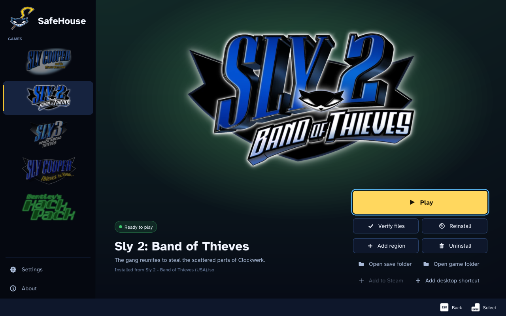
</p>

## What it is

SafeHouse installs each game from **your own PlayStation 2 disc image** and runs it as a native PC program: no
emulator, no BIOS. **SafeHouse includes no game data.**

| Game | Status |
| --- | --- |
| **Sly Cooper and the Thievius Raccoonus** | Playable. Built on [ProjectCane](https://github.com/theclub654/ProjectCane) by **theclub654**, the native PC port of Sly 1 that made SafeHouse possible. |
| **Sly 2: Band of Thieves** | A native port, fully playable from start to finish. |
| **Sly 3: Honor Among Thieves** | **Early in development, not fully playable.** Now rebuilt on the finished Sly 2 port's engine. It installs and plays its opening movies; the rest of the game is still being ported. |

Supported discs: Sly 1 from the USA, Europe, Japan and Korea; Sly 2 from the USA, Europe (v1.00 and v2.01) and
Japan. On macOS the packages carry the launcher, Sly 2 and Sly 3.

## Download and play

1. Get the latest package from the **[Releases page](https://github.com/FridiNaTor1/SafeHouse/releases)**:

   | System | Package |
   | --- | --- |
   | Windows | `SafeHouse-Launcher-Windows-x86_64-Setup.exe` (installer) or `...-Portable.zip` (unzip and open `SafeHouse.exe`) |
   | Linux / Steam Deck | `SafeHouse-Launcher-Linux-x86_64.AppImage` (make it executable and open it) or `...-Linux-x86_64.tar.gz` |
   | macOS | `SafeHouse.app` in a `.dmg` or `.zip` (Apple Silicon and Intel) |

2. Open **SafeHouse**, pick a game, choose **Install** and select (or drag in) your disc image (`.iso`).
   The image is checked first: the game, the region, the free space and whether the image is complete.
3. Choose **Play**.

The launcher keeps itself up to date: it checks for a new release at startup and updates in place, leaving your saves
and games alone ([details](docs/FAQ.md#how-do-i-update)).
On the Steam Deck, install in Desktop Mode, then use **Add to Steam** on the game's page. More help:
[FAQ and troubleshooting](docs/FAQ.md).

## PC features

<p align="center">
  <br>
  <br>
  <sub>Super ultrawide: the full 32:9 picture, with the HUD kept at its original 4:3 proportions.</sub>
</p>

- **Full keyboard and mouse support:** remappable keys and buttons, mouse camera and aim, and separate invert
  options for the camera, the binocucom and the turrets, for the controller and the mouse.
- **Controller button icons** for Xbox, Steam Controller, Steam Deck, Nintendo Switch, PS5, PS4 and PS3, or the
  original PS2 icons if you prefer them.
- **Dynamic input icons** that switch instantly to whatever you're playing with.
- **Windows, Linux, SteamOS and macOS.**
- **High refresh rates:** 30, 60, 90, 120, 144, 240 FPS, uncapped or your monitor's refresh rate; the game speed
  stays the same.
- **Super ultrawide (up to 32:9):** the HUD stays at its original 4:3 proportions, with improvements to the
  binocucom, effects and cutscene bars at wider aspect ratios.
- **A debug menu with PC extras:** play as Carmelita, guards and bosses, fly Bentley's RC chopper anywhere, noclip,
  a free camera and warps.
- **Replay Jobs:** jump back into your favourite jobs.
- **Every region:** USA (NTSC), both PAL versions in every language, and the Japanese Kaitou Sly Cooper 2.
- **Mod support:** texture, music, dialog, text and movie replacements, texture packs, and a built-in import of the
  HD textures from the PS3 Sly Collection.
- **And more:** long shadows, 30 save slots, Add to Steam and desktop shortcuts.

<table>
  <tr>
    <td width="50%">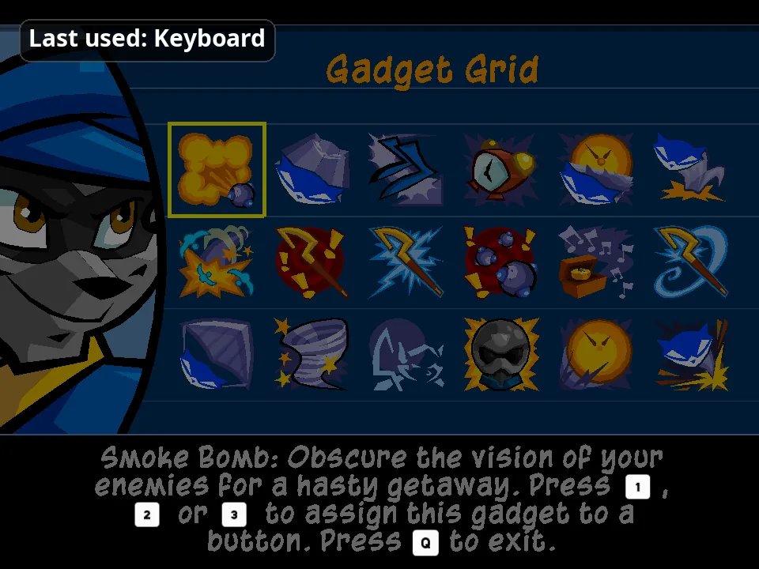<br><sub>Input icons switch instantly to what you're using</sub></td>
    <td width="50%">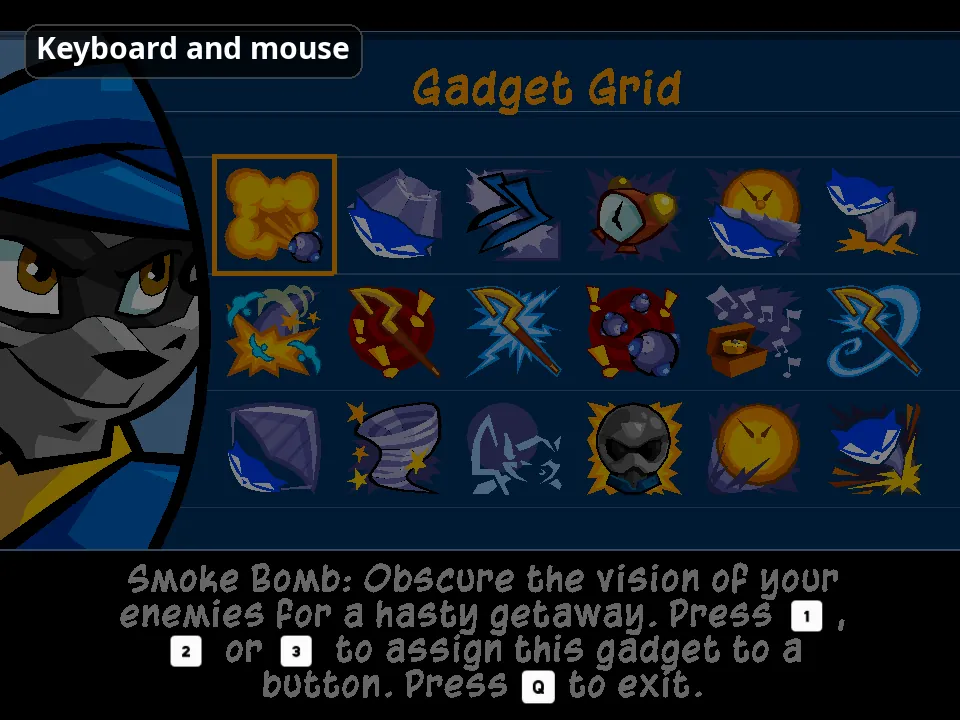<br><sub>Icons for every major controller, or the original PS2 ones</sub></td>
  </tr>
  <tr>
    <td>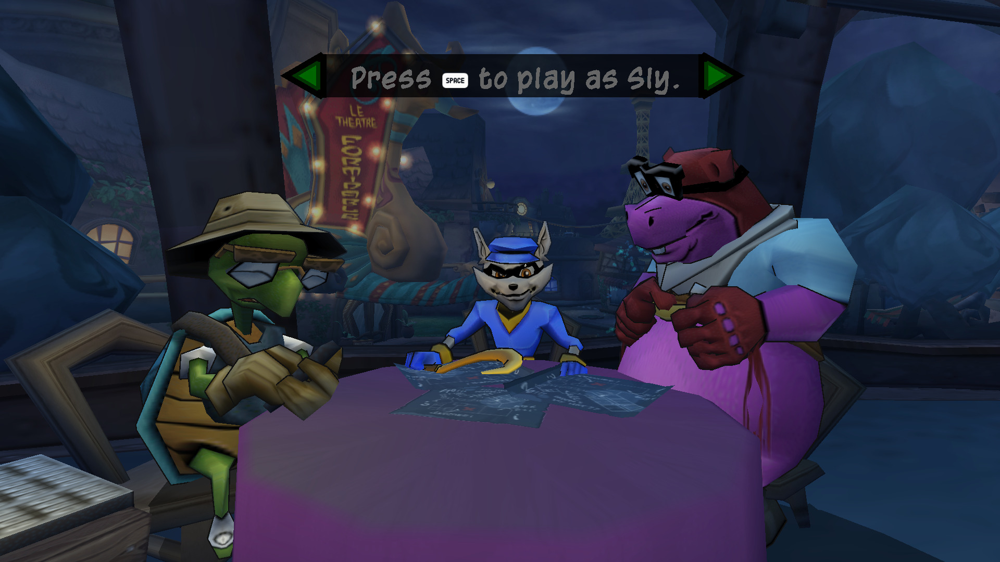<br><sub>Full keyboard and mouse support</sub></td>
    <td>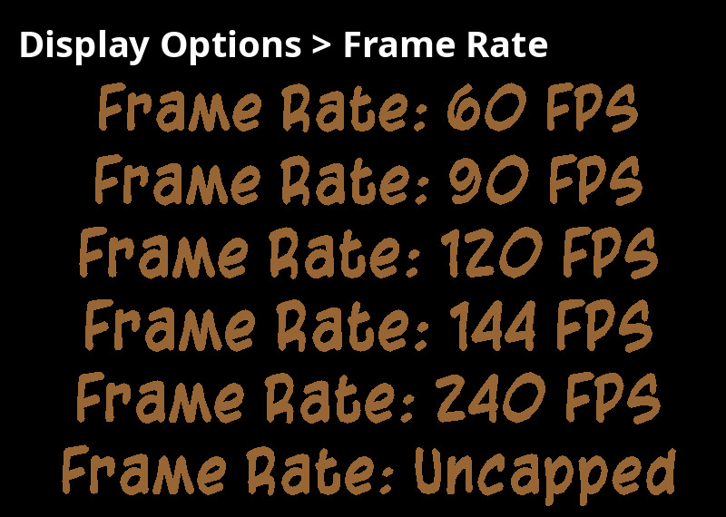<br><sub>High refresh rates, up to uncapped</sub></td>
  </tr>
  <tr>
    <td>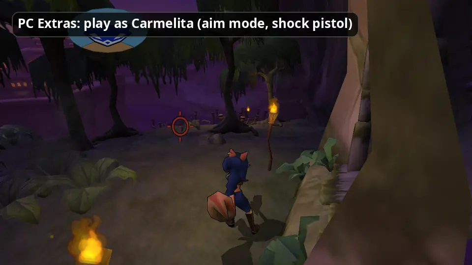<br><sub>PC Extras: play as Carmelita</sub></td>
    <td>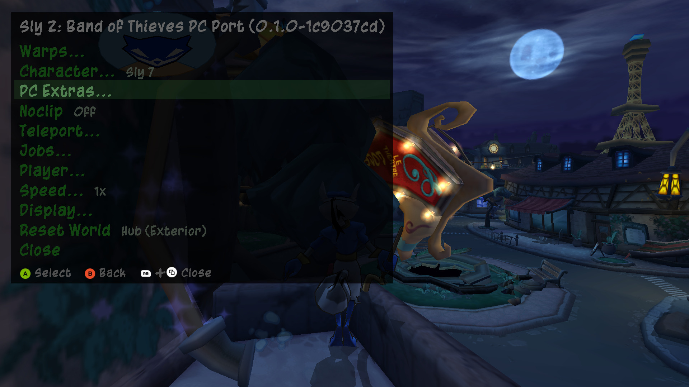<br><sub>The debug menu (F10)</sub></td>
  </tr>
  <tr>
    <td>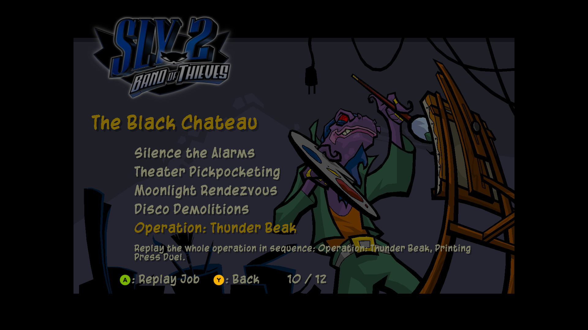<br><sub>Replay Jobs, with operations</sub></td>
    <td>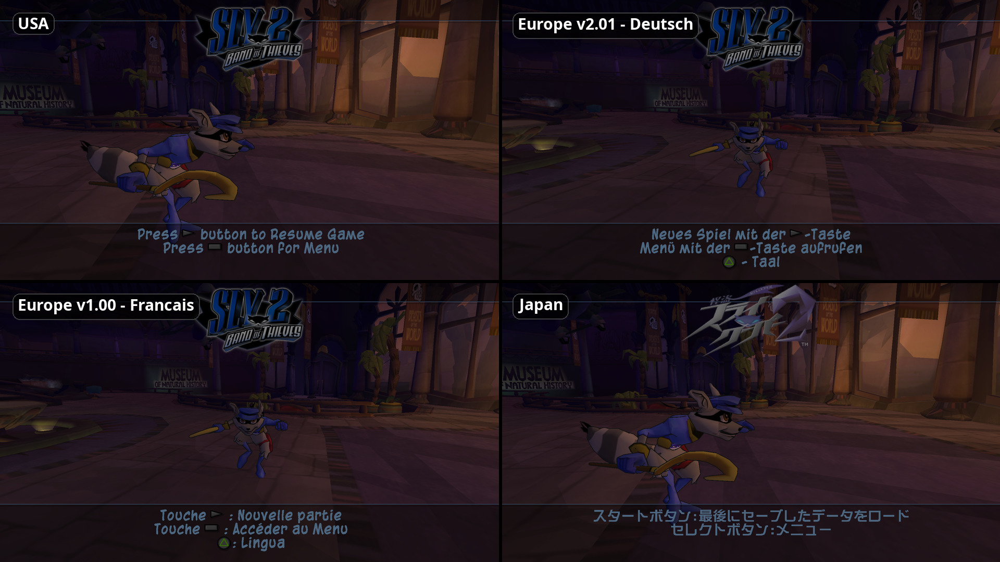<br><sub>Every region and language</sub></td>
  </tr>
  <tr>
    <td>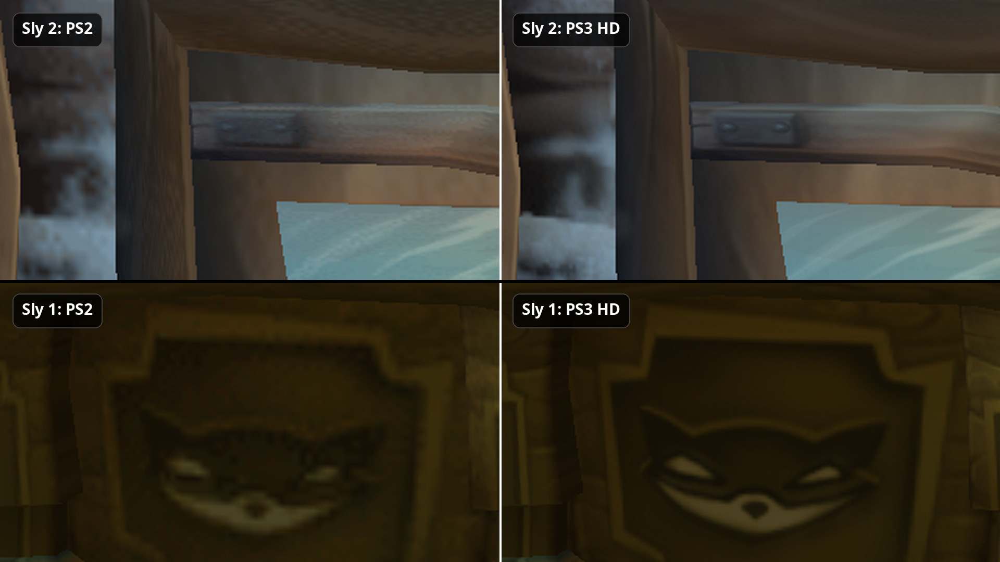<br><sub>PS3 HD texture import (Sly 2 and Sly 1)</sub></td>
    <td>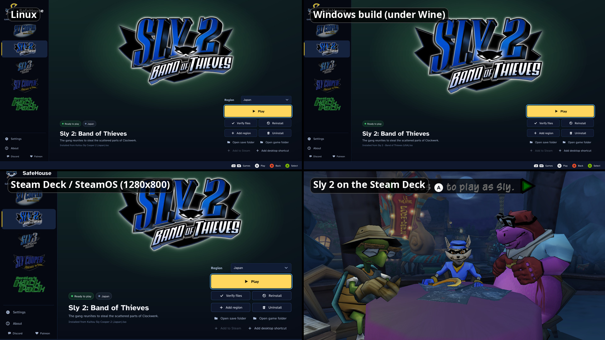<br><sub>Windows, Linux and the Steam Deck</sub></td>
  </tr>
</table>

The full list is in **[docs/FEATURES.md](docs/FEATURES.md)**, the debug menu in
**[docs/DEBUG-MENU.md](docs/DEBUG-MENU.md)** and modding in **[docs/MODDING.md](docs/MODDING.md)**.

## Community

- **Discord:** join us on the [ThiefRush Discord](https://discord.com/invite/SfvzvMg7Mk). ThiefRush is also the name
  of the multiplayer fork that is on its way.
- **Patreon:** [Support us on Patreon](https://www.patreon.com/cw/thiefrush).

Bug reports are welcome in the [issues](https://github.com/FridiNaTor1/SafeHouse/issues). Turn on **Save logs** in
**Settings > Advanced**, reproduce the problem, and attach `launcher.log` from **Log folder**.

## Building from source

See **[docs/BUILDING.md](docs/BUILDING.md)**. In short, on Ubuntu 22.04 or newer:

```sh
cmake --preset linux-release
cmake --build --preset linux-release --parallel 4
```

## Credits

- **[ProjectCane](https://github.com/theclub654/ProjectCane) by theclub654:** the native PC port of Sly 1. SafeHouse
  grew out of it; without it none of this would exist.
- **Antonio Mena:** work on the Sly 2 port and the macOS port.
- **HoshiYumeHime** (DeviantArt): the SafeHouse logo and the app icon.
- **SteamGridDB artists** (ctwoafiveb, Benuno, AnimeFan69, Spaghetti Overlord, Pedrogon18, RealSayakaMaizono, Nuke,
  simenfje, FrostWolf): the Steam library artwork (`launcher/assets/steam/CREDITS.md`).
- **Kenney** ([kenney.nl](https://kenney.nl)): Input Prompts (CC0), the controller button icons.
- **SDL_GameControllerDB:** the controller mappings.
- **The Braille Institute:** the Atkinson Hyperlegible typeface.
- **The libraries** SafeHouse uses: GLFW, SDL2, FAudio, Dear ImGui, GLAD, GLM, stb, nlohmann/json, miniz, PicoSHA2
  and FFmpeg. Their licences are in [`THIRD_PARTY_NOTICES.md`](THIRD_PARTY_NOTICES.md) and [`licenses/`](licenses).

And at the root of the Sly 2 port: the **[Sly 2 decompilation](https://github.com/Komasia/sly2-decomp)**.

## Legal

SafeHouse is an unofficial fan project. It is not affiliated with or endorsed by Sony Interactive Entertainment,
Sucker Punch Productions or Sanzaru Games. Sly Cooper and the related names, logos and characters are their
trademarks, used here only to identify the games.

SafeHouse contains no game data. You must own the games and use your own disc images.
