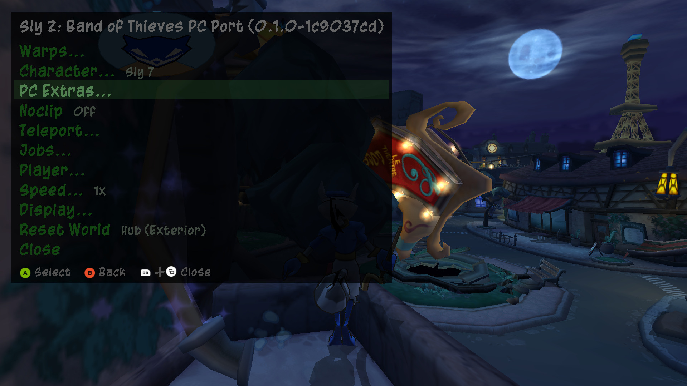
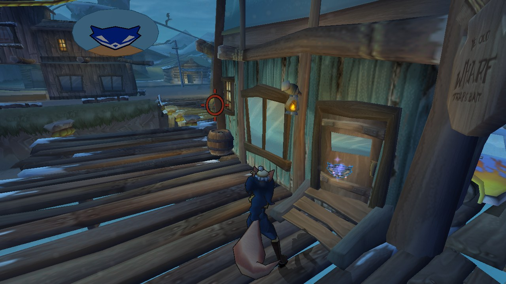
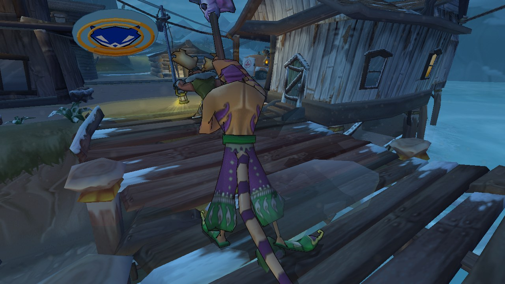
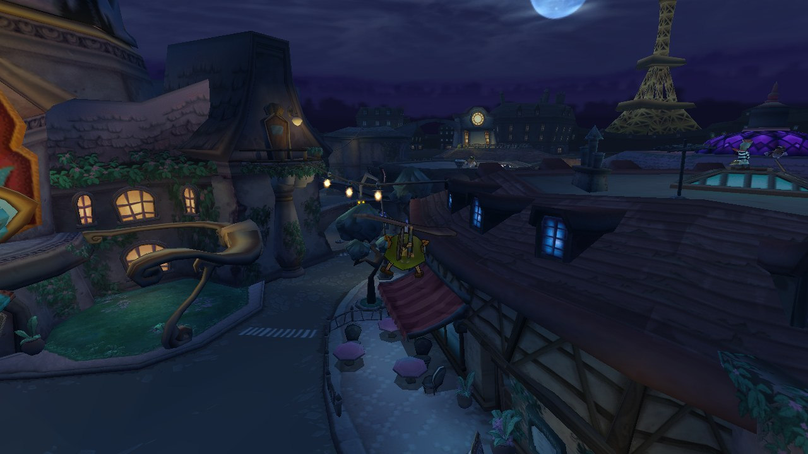

# The debug menu and Extras

[Back to the README](../README.md)

Sly 2 has a PC debug menu in the style of the Sly 2 prototype's debug menu, with extras the original never had. Sly 1
has the same menu, opened the same way, with its own pages ([Sly 1](#sly-1)). It is
not part of normal play: turn on **Settings > Advanced > Debug mode** in the launcher (while the game is closed). That
one switch turns on the debug menu, the debug keys below and the games' other debug features; with it off none of them
does anything.

Rows marked **[save]** change your progress (see [Jobs](#jobs) and [Player](#player)). Everything else leaves the save
alone. Back up your saves before experimenting.

## Opening and moving around

- **Open / close:** **F10**, or hold **R1** and press **Select** on a controller.
- The game is **frozen** while the menu is open (music and a dialog line already playing go on).
- **Move:** D-pad, left stick, arrow keys, W / S or the mouse wheel (or point at a row with the mouse).
- **Select:** Cross, Enter, Space or a left click.
- **Back:** Circle, Triangle, Esc, E, Q or a right click. Back from the first page closes the menu.
- The title line shows the port's version.

## The pages

| Page | What it does |
| --- | --- |
| **Warps** | An episode, then any of its worlds (the hub, the interiors, the job worlds), by the game's own names. The world loads as in normal play, at its entrance. |
| **Character** | Makes Sly, Bentley or Murray the player, at the current character's place, among the characters the world has loaded (not from inside the safe house). |
| **Extras** | Play as Carmelita, guards and bosses, Sly's tango outfit, and Bentley's RC chopper. See [Extras](#extras). |
| **Noclip** | Fly the current character through walls. See [Noclip](#noclip). |
| **Teleport** | Puts the player on one of this world's checkpoints or warp points. |
| **Jobs** | **Complete Current Job [save]** (as F9), or **start** one of this world's jobs the way the game does. |
| **Player** | Infinite health and power (F7), a refill, unlock all gadgets / 9999 coins / all characters (F6) **[save]**, Save Game Now (F5) **[save]**. |
| **Speed** | The game's speed, from 0.1x to 4x, and **Freeze Time** (F8). See [Game time](#game-time). |
| **Free Camera** | The free camera (F1) and the **Freeze Camera** (Shift+F1). See [The free camera](#the-free-camera) and [Freeze Camera](#freeze-camera). |
| **Display** | Hide the HUD (F11), a performance line (frame rate, world, position). |
| **Reset World** | Reloads the current world at its entrance. |

## Noclip

Flies the current character with no collision or gravity; the camera passes through walls too. Health and power stay
full while flying. Turning it off (the menu again) drops the character back into normal physics where it is.

| Controller | Keyboard | Action |
| --- | --- | --- |
| Left stick | W A S D | Move level, relative to the camera |
| Cross / R2 | Space / 3 | Up |
| Circle / L2 | E / 2 | Down |
| R1 held | Shift | 4x faster |
| L1 held | 1 | 4x slower |
| Right stick | Mouse | Camera |

## The free camera

**F1**, or **Free Camera > Free Camera**. The game keeps running while you move the camera.

| Controller | Keyboard / mouse | Action |
| --- | --- | --- |
| Left stick | W A S D | Move along the view / strafe |
| Right stick | Right mouse button held | Look around |
| R2 / L2 | E / Q | Up / down |
| R1 held / L1 held | Left Shift (faster) | Faster / slower |
| Select | F1 | Leave |
| R1 + Select | | Leave and open the debug menu |

## Freeze Camera

**Shift+F1** (each press: Off, Fixed, Follow, Off), or **Free Camera > Freeze Camera**. For shots and videos while
you play: the camera stays where it is and you get full control of the character (moving, jumping, attacks, gadgets,
power-ups, the menus).

- **Fixed:** the view stays exactly as it was (place and direction).
- **Follow:** the camera stays in place but turns smoothly to keep the character in view.
- It freezes the view on screen at that moment: the game's camera, or the free camera's. To pick a spot, fly the free
  camera there (F1), then press Shift+F1: the view stays and the controls go back to the character.
- The right stick and the mouse don't move a frozen camera.
- Cutscenes, conversations and the binocucom show their own cameras; the frozen view comes back after them. Loading
  another world or level turns it off. F1 (the free camera) starts from the frozen view and replaces it.
- Sly 2 and Sly 3: the stick moves the character relative to the game's own camera, which keeps following behind the
  frozen view. Sly 1: the stick moves the character relative to the frozen view.

## Game time

| Key | Menu | What it does |
| --- | --- | --- |
| F8 | Speed > Freeze Time | Freezes or unfreezes time. The world stops as under the pause menu but nothing opens: the free camera can still fly and the Freeze Camera keeps working. The character takes no input meanwhile. |
| Shift+F8 | Speed | Faster: 1x, 1.5x, 2x, 4x. |
| Ctrl+F8 | Speed | Slower: 1x, 0.5x, 0.25x, 0.1x. |

A short note at the top of the screen shows the new setting. While the speed isn't 1x or time is frozen, a small note
stays in the bottom-left corner (hidden with the HUD, F11). The sound follows the game the same way as from the Speed
page. Loading another world or level unfreezes time; the speed stays.

## Extras

Not in the original game. Each guest is loaded from its own world's files while the current world keeps running (the
first time takes a moment; after that switching is instant). Nothing here is saved; choosing Normal, or turning Debug
mode off, puts everything back.

### Carmelita

**Extras > Characters > Carmelita:** her Prologue, Episode 6 (snow) or Episode 2 (tango dress) model, on Sly,
Bentley or Murray. With **Her moves** on (the default) she plays with her own moveset:

| Button | Carmelita |
| --- | --- |
| Left stick | Walk (a slight push walks slowly) and turn |
| R1 held | Run |
| Cross | Jump; Cross again in the air: her double jump with its flip |
| Circle | The interaction in reach (doors, switches, talking), otherwise her high jump |
| Square | Her shock pistol |
| Triangle | Aim mode on / off: she strafes and fires where the camera looks |

With **Her moves** off she follows the player's own moves (ledges, ropes and gadgets show her idle / run / jump).

**Sly outfit: Tango** dresses Sly in his ballroom tuxedo with all his usual moves.

### Guards and bosses

**Extras > Guards > Episode n** lists every guard type of that episode; **Extras > Bosses** has four bosses. The
player keeps Sly's camera, health and HUD, with the guard's model, animations and attacks: **Square** and **Circle** use
the guard's own attacks (strikes, shots, missiles, thrown objects), and their hits knock out other guards with the
game's own hit code. The menu row shows each character's controls.

### Bentley's RC chopper

**Extras > Characters > Bentley's RC chopper** flies the RC chopper from Episode 2's RC Bombing Run in any world.
Choose the row again (or switch character) to get the player back.

| Controller | Keyboard / mouse | RC chopper |
| --- | --- | --- |
| Left stick up / down | W / S | Fly forward / back |
| Left stick left / right | A / D | Turn |
| R2 / L2 | 3 / 2 | Climb / sink |
| Square | Left click | Forward gun (aims at the nearest guard ahead) |
| Cross | Space | Drop a bomb |
| Right stick | Mouse | Orbit the camera |
| R3 | The key bound to R3 | Chase camera / top-down camera |

## Sly 1

The same menu, keys and look (F10, or R1 + Select; the game stands still while it is open). Sly 1 keeps its own
developer window on **F3** as well (Display > Developer Window). Its pages:

| Page | What it does |
| --- | --- |
| **Warps** | A world (Paris and the Hideout, Tide of Terror, Sunset Snake Eyes, Vicious Voodoo, Fire in the Sky, The Cold Heart of Hate), then any of its levels by name. The level loads with the game's own fade, at its start. |
| **Noclip** | Fly the player through walls, as in Sly 2 ([Noclip](#noclip): the same controls). The player's own moves and physics stop while flying; turning it off drops it back into normal physics where it is. |
| **Teleport** | Puts the player on one of this level's checkpoints or warp points (the game's own warp). |
| **Level** | **Finish Level [save]** (F9: the level's key collected the game's own way; a level without a key is marked done and you return to its hub), collect all clue bottles **[save]**, all keys of this world **[save]**, the next level (F4), Save Game Now (F5) **[save]**. |
| **Player** | Infinite health (F7: invulnerable, charms never run out), no death barriers, 2 charms / 99 coins / 9 lives **[save]**. |
| **Unlock** | Everything (F6), the power-ups, every world and level in the Hideout, the Hideout's movies **[save]**. |
| **Speed** | The game's speed, from 0.1x to 4x, and Freeze Time (F8), as in Sly 2. |
| **Free Camera** | The free camera (F1) and the Freeze Camera (Shift+F1), as in Sly 2. |
| **Display** | Hide the HUD (F11), the performance line, the developer window (F3). |
| **Overlays** | The collision, the dialogue triggers, the objects' names, the performance line. |
| **Reset Level** | Reloads the current level at its start. |

## Debug keys

With Debug mode on, these keys work in the games:

| Key | Game | What it does |
| --- | --- | --- |
| F1 | Sly 1 | Toggles the free camera. |
| F2 | Sly 1 | Goes to the Hideout. |
| F3 | Sly 1 | Opens or closes the developer window. |
| F4 | Sly 1 | Goes to the next level. |
| F5 | Sly 1 | Saves the game (the slot being played). |
| F6 | Sly 1 | Unlocks every power-up, every world in the Hideout and its movies; 2 charms, 99 coins. |
| F7 | Sly 1 | Toggles infinite health. |
| F9 | Sly 1 | **Finishes the current level** (collects its key). |
| F10 | Sly 1 | Opens or closes the debug menu (controller: R1 + Select). |
| F11 | Sly 1 | Hides or shows the HUD. |
| F1 | Sly 2 | Toggles the free camera. |
| F2 | Sly 2 | Goes to the Paris hub. |
| F3 | Sly 2 | Goes to the next world. |
| F5 | Sly 2 | Saves to the slot being played (slot 1 if none). |
| F6 | Sly 2 | Unlocks every gadget and power-up, sets 9999 coins and makes every character selectable. |
| F7 | Sly 2 | Toggles infinite health and gadget power. |
| F9 | Sly 2 | **Completes the current job.** |
| F10 | Sly 2 | Opens or closes the debug menu (controller: R1 + Select). |
| F11 | Sly 2 | Hides or shows the HUD, for clean screenshots. |
| Shift+F1 | Sly 1, 2, 3 | Freeze Camera: Off, Fixed, Follow ([Freeze Camera](#freeze-camera)). |
| F8 | Sly 1, 2, 3 | Freezes or unfreezes time ([Game time](#game-time)). |
| Shift+F8 | Sly 1, 2, 3 | Faster (up to 4x). |
| Ctrl+F8 | Sly 1, 2, 3 | Slower (down to 0.1x). |

**F9** is meant for getting past a softlock. It ends the job you are in as if every remaining task had been done: the
game's own "Job Completed!" screen, closing sequence and autosave run, the job is saved as completed and the next jobs
unlock as usual. Outside a job it does nothing. Each use prints the job and task it skipped to the game's log (in
`launcher.log` with **Save logs** on), which is useful in a bug report.

Sly 3 has the debug menu too (F10); the free camera (F1), the Freeze Camera and the game-time keys work there the
same way.
