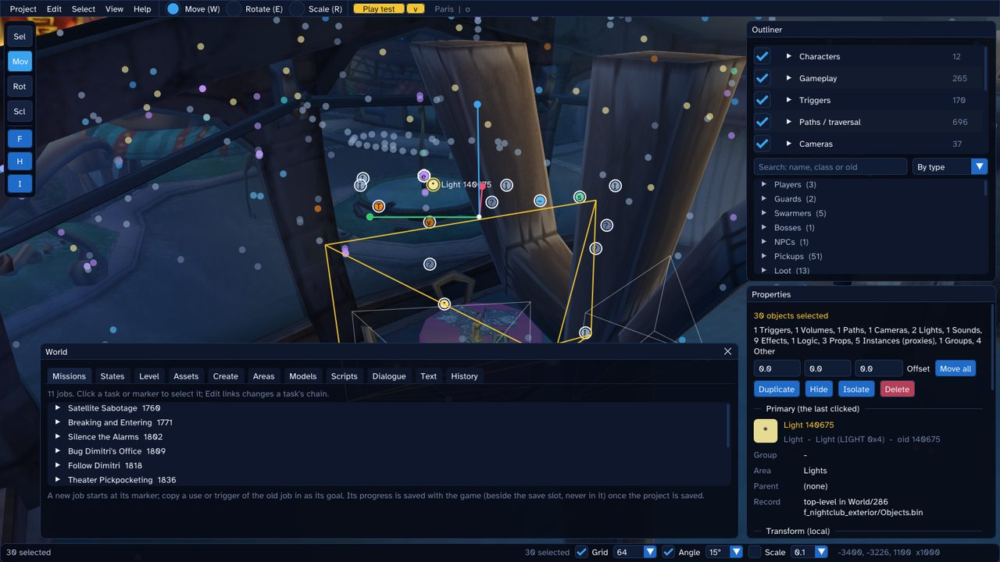
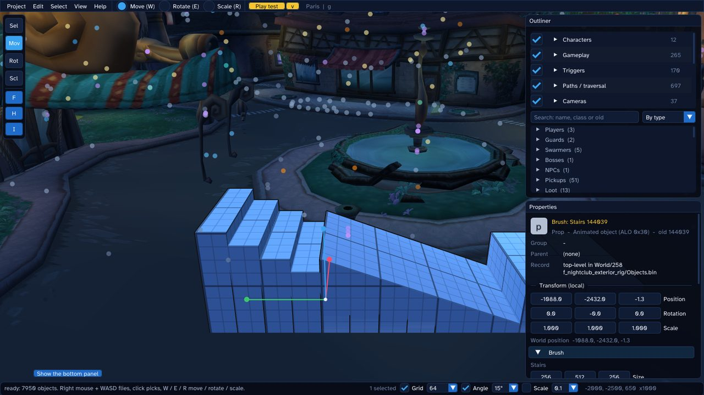
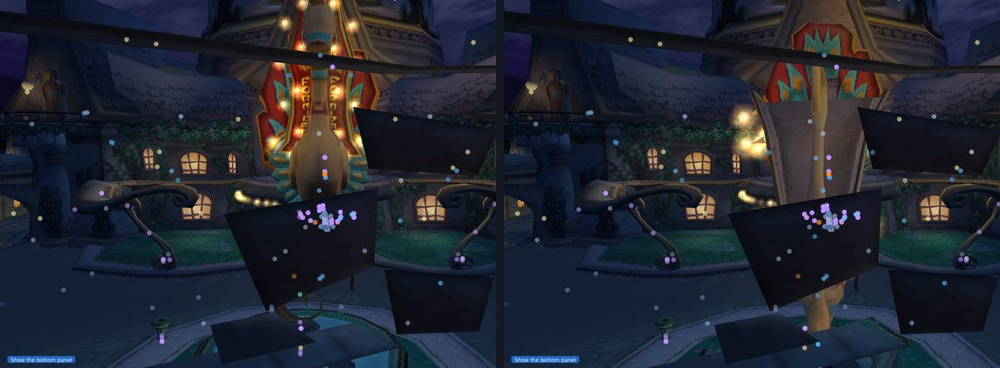
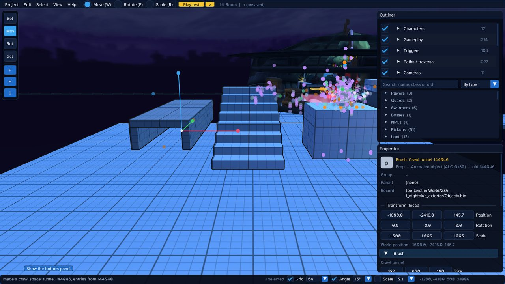
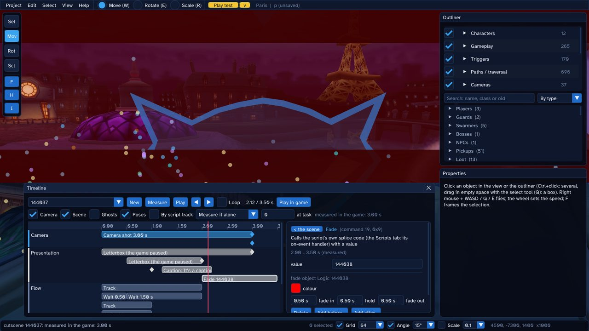
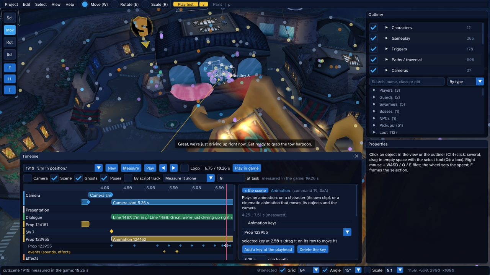
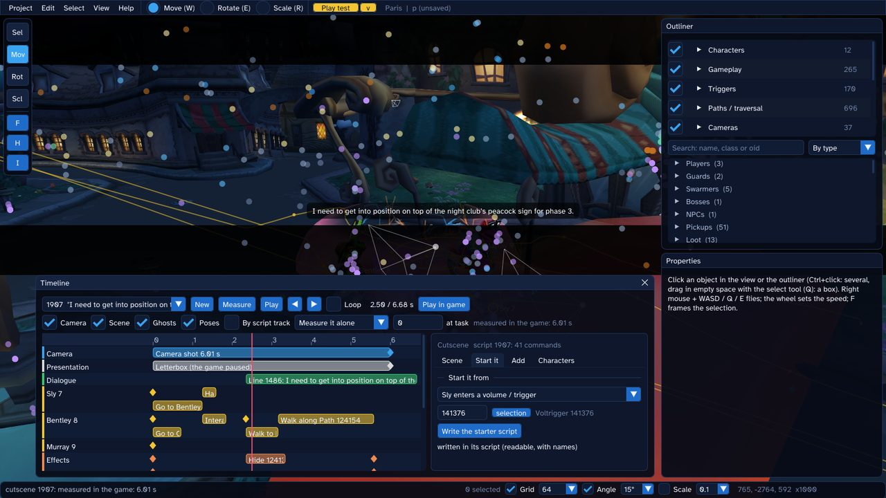

# Modding Sly 1 and Sly 2 in SafeHouse

SafeHouse installs each game from your own disc into a folder of ordinary files. This guide covers where those files
are, how to replace textures, music, dialog, text, movies and levels, which tools come with SafeHouse, and what is
safe to change.

Both games have a **Mods folder**: you drop replacement files into it, and the game uses them instead of the
originals. The installation itself is never touched, so removing a file from Mods brings the original back.

---

## Sly 2: Band of Thieves

### Where things are

| What | Linux | Windows | Portable SafeHouse |
|---|---|---|---|
| The installation (read only for mods) | `~/.local/share/SafeHouse/installations/sly2` | `%LOCALAPPDATA%\SafeHouse\installations\sly2` | `data/installations/sly2` |
| **Your Mods folder** | `~/.config/SafeHouse/sly2/Mods` | `%LOCALAPPDATA%\SafeHouse\user\sly2\Mods` | `data/user/sly2/Mods` |

- A second region, such as Europe installed beside USA, is in `installations/sly2-europe`. The Mods folder is shared
  by both.
- SafeHouse's **Open game folder** button opens the installation.
- Create the `Mods` folder if it doesn't exist.
- When the game starts with mods, its log prints `mods: N files from ...`.

The installation looks like this:

```text
sly2/
  extraction_manifest.json        the index: every file, what it is, and which levels use it
  Worlds/<N> <Episode>/<Level>/
      <Level>.world.json          the level's parts, in the order the game reads them (see "Levels")
      World/Text.json             its text and subtitles, every language (editable)
      World/<nnn> <group>/        one folder per group of the level (Sly, Murray, a guard, a door, the level itself):
          Scripts.splice              its scripts, as text (editable)
          Graphics.bin                its textures and shaders
          Objects.bin                 its objects: models, animations, actors (the index lists each one)
      World/Groups.bin, Sound.bin, Progress.bin, ...   the level's other blocks
      <Level>.bnk                 its sound effects' definitions
      Sounds/Sound <n>.wav        its sound effects, one WAV per sample
      Ambience.wav                its background ambience
      Screens/Screen <id>.brx     a menu or HUD screen only this level uses
  Worlds/Front End/Front End.brx  the title screen and menus
  Screens/Screen <id>.brx         HUD screens every level uses
  Music/<id> <name>.wav           the music, for example "28 Paris.wav"
  Dialog/<Language>/<Level>/<line>.wav   a voice line ("Shared" holds lines every level uses)
  Movies/<id> <name>.m2v          a movie's picture, for example "2009 Ep1 Intro.m2v"
  Movies/<id> <name>.wav          its sound
```

The audio is ordinary WAV (16-bit PCM), which any audio editor opens. On the European discs, with 11 languages, the
voice lines and the movies' sound are **FLAC** instead (lossless, about 60 % of the size; Audacity and most editors
open it): `Dialog/French/Paris/1259.flac`, `Movies/French/2062 Ep1 Intro.flac`. The game plays exactly the sound
of the disc from these files.

Examples: `Worlds/1-Paris/World/227 jt/Scripts.splice` (Sly's scripts in Paris), `Music/18 The Jungle.wav`,
`Movies/2013 Ep2 Operation Hippo Drop.m2v`.

**The rule: a file in Mods at the same path as a file of the installation replaces it.** For example,
`Mods/Music/28 Paris.wav` replaces `Music/28 Paris.wav`.

Music and movies also match by their **number** alone:

- `Mods/Music/28.wav` or `Mods/Music/28 My Theme.wav` replaces track 28.
- `Mods/Movies/2009.m2v` replaces movie 2009's picture, `Mods/Movies/2009.wav` its sound.

The PS2 formats of older SafeHouse versions still work in Mods: a `.vpk` replaces a music track, a `.vag` a voice
line, a `.pss` a whole movie (picture and sound).

**Short names (SafeHouse from 2026-11-17).** Installations made since then name a level's folder
`Worlds/<episode>-<level>` (`Worlds/1-Paris`) and an object group's folder by its first 20 characters
(`World/258 f_nightclub_exterior`), so the paths stay well below Windows' 260 characters. Installations made before
keep their names (`Worlds/1 The Black Chateau/Paris`, `World/258 f_nightclub_exterior_rig`), and a mod made
against either names works on both: the game matches the mods folder's files by the short names.

Use the number when you share a mod: names can change between SafeHouse versions, numbers don't. Movie numbers
differ between the USA and European discs: the European Ep 1 intro is 2062. Music numbers are the same on both.

### The tools

The tools are options of the game program **Sly2-Release** (`Sly2-Release.exe` on Windows), which is in SafeHouse's
program folder. Run them from a terminal.

**The audio tools need no game data:**

```sh
Sly2-Release --export-wav "<installation>/Music/28 Paris.wav" paris-normal.wav --stem 1
Sly2-Release --make-music "Mods/Music/28 Paris.wav" mytrack.wav --like "<installation>/Music/28 Paris.wav"
```

Voice lines, movie sound and sound effects need no tool: put a WAV in Mods.

**The dumps need the installation** (`--disc` takes the installation folder):

```sh
Sly2-Release --disc "<installation>" --dump-text text
Sly2-Release --disc "<installation>" --dump-textures textures 2
```

`--dump-textures` takes a level by its record number, as listed in `extraction_manifest.json` under `worlds`:
2 is Paris, `boot` is the museum prologue, `frontend` is the menus.

To try a different Mods folder, use `--mods DIR`. An empty value (`--mods ""`) starts the game with no mods.

### Textures

1. Find the texture. **The installation already has every texture:** the `Textures` folder in the game folder (the
   launcher's **Open game folder**) holds all 7051 of them as `<W>x<H>_<hash>.png` (about 80 MB). The name
   identifies the texture by its contents.

   - Installed before 2026-11-04 and no `Textures` folder? Press **Export textures** on the launcher's Sly 2 page
     (about 10 seconds), or run `Sly2-Release --data-dir "<installation>" --export-textures`. No re-extract needed.
   - Only one level's textures: `Sly2-Release --disc "<installation>" --dump-textures dump 2` writes what Paris
     draws to `dump/`.

2. **Copy** the PNG into `Mods/Textures/` under the **same file name**, and edit the copy. (Leave `Textures`
   itself alone: it is the reference, and the game never reads it.)

The texture is then replaced wherever the game draws it: in every level, on characters, on HUD screens, in
animated (multi-frame) textures and in particles.

- **Higher resolution:** a replacement is used **at its own resolution, not stretched or scaled back down**. The
  game's texture coordinates run 0..1 across the texture, so a 4x PNG (a 64x64 texture as 256x256) maps exactly like
  the original and shows four times the detail. The width and height don't need to be the original's multiple or
  aspect, but keeping them a whole multiple (2x, 4x) keeps every detail where the original had it.
- **Filtering:** each replacement gets mipmaps, so a large texture doesn't shimmer in the distance. Textures the
  game draws smooth are drawn smooth (trilinear, with anisotropic filtering), and textures it draws with sharp
  pixels stay sharp.
- **Recommended limits:** 4x the original (most textures become 128x128 to 1024x1024; the largest, 512x128, becomes
  2048x512) and at most 4096 pixels a side. A whole level at 4x uses about 300 to 550 MB of video memory in place of
  about 25 MB, and loads about half a second slower. Only the current level's textures are kept. On the Steam Deck
  or a 2 GB card, use 2x for whole-level packs and save 4x for close-up details. 8x and above costs 4x as much again,
  for detail the camera rarely gets close enough to see. Replacements over 16384 pixels or over the GPU's limit are
  ignored.
- **Alpha:** 255 is fully opaque. The game's own range is half that, and SafeHouse converts it both ways, so a
  dumped PNG put back unchanged looks identical. Upscaled edges with in-between alpha are fine.
- **Texture cache:** the first time a replacement is drawn, the game keeps its decoded picture in a cache file, so the
  next load does not read and decode the PNG again. A PNG you add or change is picked up by itself (the cache goes by
  the file's name, size and time; for a pack's `Textures.pak` by that file's size and time), and a removed one is
  dropped. The picture is the same with and without the cache. It lives in your cache folder (Linux:
  `~/.cache/SafeHouse/sly2/Textures`, Windows: `%LOCALAPPDATA%\SafeHouse\Cache\sly2\Textures`, macOS:
  `~/Library/Caches/SafeHouse/sly2/Textures`, a portable copy: `data/cache/sly2/Textures`, Switch and Android:
  `Cache/Textures` in the Sly 2 profile folder) and can be deleted at any time: `Sly2-Release --clear-texture-cache`
  does it. `Sly2-Release --data-dir "<installation>" --build-texture-cache` (with `--texture-pack DIR` for a pack)
  fills it ahead of time. `Texture Cache = Off` under `[Graphics]` in `Settings.ini` turns it off; on the Nintendo
  Switch it is off unless you set it to `On` (it takes about two thirds of the pack's size on the SD card again).
  (Sly 3 has the same cache, with `sly3` in place of `sly2`.)
- **Sly 3's 3-D mode and two-player games use other textures.** A replacement is found by the texture's own pixels.
  In the 3-D mode Sly 3 loads its worlds with other textures (other images, often smaller, and colours adjusted for
  the glasses), and its two-player games (Cops and Robbers, the two-player hacking game, the duels) load the second
  set of textures the world files carry. A pack made in normal play therefore does not change those modes; dump the
  textures in those modes as well (play them with your mods folder's dump) and include them in the pack.
- **Texture streaming:** replacements load on the processor's other cores while the game goes on, so a texture can
  show its original for a moment when it first appears instead of the game pausing; a level starts with its
  replacements in place where the computer is fast enough. `Texture Streaming = Off` under `[Graphics]` in
  `Settings.ini` loads each replacement the moment it is first drawn instead.
- **Shared textures:** a texture used by several levels has the same name in each, so one PNG covers all of them.
- **Animated textures and particles:** each frame is its own PNG. Give all the frames of one animation the same
  size (particle frames of another size are scaled to the first replaced frame's size).
- Start the game with `SLY2N_MODSTATS=1` set to have its log list each replacement it uploads and the video memory
  they use.
- **Converting by hand:** `Sly2-Release --disc "Sly 2.iso" --convert sly2-files` writes the `Textures` folder too;
  `--no-export-textures` leaves it out.

### The PS3 HD textures (The Sly Collection)

If you own **The Sly Collection** for PS3, SafeHouse can take its redrawn textures (up to 4x sharper) and use them
over Sly 2's: **Settings > Games > Sly 2: Band of Thieves > Import PS3 HD textures**. Choose the PS3 disc image
(`.iso`), a `.zip` of it (read as it is, nothing is unpacked), or the extracted disc (the folder with `PS3_GAME`).
It takes about 6 minutes and writes one file of about 200 MB (5989 textures), `PS3 HD/Textures.pak`, in your Sly 2
profile folder (`~/.config/SafeHouse/sly2/PS3 HD`, `%LOCALAPPDATA%\SafeHouse\user\sly2\PS3 HD`).

- `Textures.pak` holds the PNGs under the same `<W>x<H>_<hash>.png` names as any texture pack, in one file that loads
  and copies much faster than thousands. Your own `Mods/Textures` win over it, so you can still change single
  textures.
- **Extract as PNG files** makes the next import write the PNG files in `PS3 HD/Textures` instead, to look through or
  edit them. The game reads either.
- **Use the PS3 HD textures** turns it on or off; **Remove** deletes it. The game itself never reads the PS3 disc:
  levels, scripts and gameplay stay the PS2's.
- Without the launcher: `Sly2-Release --data-dir "<installation>" --ps3-hd-textures "<PS3 disc, .iso or .zip>" OUT`
  builds the pack (add `--ps3-hd-png` for the PNG files), and `--texture-pack OUT` uses it.
- A pack imported before `Textures.pak` (a `PS3 HD/Textures` folder of PNGs) still works.
- On the Nintendo Switch, copy the `PS3 HD` folder to `sdmc:/switch/SafeHouse/user/sly2/`. The game's cover in
  SafeHouse shows an HD tag when it is found.
- Only the textures are taken: the PS3's cutscenes, music and voices are the same quality as the PS2's.

### Music

Each music track is one WAV. Most free-roam tracks have three **stems** the game cross-fades:

- **sneak** (mono), when Sly is sneaking;
- **normal** (stereo);
- **alert** (stereo), when guards spot you.

The WAV has a channel for each: Paris's five channels are sneak, normal left, normal right, alert left, alert right.
Battles, chases and menus have one plain stereo stem. The WAV also says where the loop starts (its `smpl` chunk,
which samplers and many editors show as a loop marker) and which channel is which stem (a `stem` chunk).

**The simplest replacement** is any WAV, for example a stereo song at `Mods/Music/28.wav`. It plays the same whether
you sneak or get spotted, and loops whole.

**With stems and a loop point**, build the track with `--make-music`:

```sh
Sly2-Release --make-music "Mods/Music/28 Paris.wav" normal.wav \
    --like "<installation>/Music/28 Paris.wav" --sneak sneak.wav --alert alert.wav --loop 14.9
```

- **`--like`** copies the original's stem layout, so the game's mixing keeps working. Always use it with the
  track you replace. Without `--like` you get one plain stereo stem.
- **Stems:** `--sneak` and `--alert` are optional. Without them, the normal WAV is used for every stem, which
  means your track plays the same whether you sneak or get spotted.
- **`--loop SECONDS`** is where the music jumps back to after the end. The default, 0, loops the whole file.
  `--loop none` plays the track once. The loop is sample-exact.
- **WAV formats:** 16-bit or 24-bit PCM or 32-bit float, mono or stereo. 44100 Hz is what the game uses. Other rates
  play too.
- **Getting the original:** `--export-wav` gives one stem of the original as a WAV, with its loop point: `--stem 1`
  the normal one (the default), `--stem 0` the sneak one, `--stem 2` the alert one.
- An edited copy of an installed track that lost its `stem` chunk (some editors drop unknown chunks) still mixes
  right when it keeps the original's channel count: the game takes the stems from the installed track.

Each level's background ambience (`Ambience.wav`) works the same way.

Track numbers and where they play are in the table below.

| # | Track | # | Track |
|---:|---|---:|---|
| 36 | Museum (prologue) | 34, 35 | Episode menus |
| 28 | Paris (Ep 1 hub) | 29 | Wine Cellar (Ep 1 interiors) |
| 23 | India (Ep 2 hub) | 24 | Guest Rooms (Ep 2 interiors) |
| 18 | The Jungle (Ep 3 hub) | 19 | Spice Factory |
| 14 | Prague (Ep 4 hub) | 15 | Prison |
| 10 | Contessa's Castle (Ep 5 hub) | 11 | The Crypt (Ep 5 interiors) |
| 7 | Train Station (Ep 6 hub) | 8 | Cabins (the train) |
| 3, 4 | Sawmill hub, Sawmill interiors (Ep 7) | 6 | Jean Bison Battle |
| 0 | Arpeggio's Airship (Ep 8 hub) | 1 | Clockwerk Assembly (blimp interiors) |
| 2 | Clock-La Battle | | others: jobs, chases and bosses, named by place |

### Dialog

Voice lines are mono WAV files (22050 Hz, 16-bit):

- `Dialog/<Language>/<Level>/<line>.wav`: a line one level uses;
- `Dialog/<Language>/Shared/<line>.wav`: a line every level uses.

To replace one:

1. Find the line: listen to the WAVs. The manifest lists every line with its level and length.
2. Record your line and save it as a WAV, ideally 22050 Hz mono, like the game's. Any rate, mono or stereo, plays.
3. Put it at the same path in Mods: `Mods/Dialog/English/Paris/1259.wav`.

The subtitle's timing and the lip sync come from the level, not the audio, so keep your line about as long as the
original. The manifest's `seconds` field gives the original length.

On European installations every line exists once per language, as FLAC: `Dialog/French/Paris/1259.flac`. A WAV or a
FLAC at that path (`Mods/Dialog/French/Paris/1259.wav` works too) replaces it.

### Text and subtitles

All on-screen text (menus, HUD, job names, hints, subtitles) can be replaced per language with
`Mods/Text/<Language>.json`:

1. Dump the current strings. This writes one file per language on your disc (`English.json`; on European discs also
   `French.json`, `German.json` ...):

   ```sh
   Sly2-Release --disc "<installation>" --dump-text text
   ```

2. Copy the strings you want to change into your own file:

   ```json
   {
     "strings": {
       "5": "Press START button for a New Heist",
       "305": "Press &2X&. to play as Sly."
     },
     "worlds": {
       "Paris": { "306": "This line only changes in Paris." }
     }
   }
   ```

3. Save it as `Mods/Text/English.json` (or `French.json`, ...).

How the file works:

- **`strings`** applies everywhere; **`worlds`**, keyed by the level's name as in the installation's folders, applies
  only in that level and wins over `strings`.
- **Keys** are the string numbers from the dump. You only need the strings you change. You can't add new numbers.
- **Encoding:** write the file as UTF-8. The USA and European fonts have the Western European (Latin-1)
  characters, such as é, ß, ñ and å, and the discs' own typographic marks (’ ‘ “ ” … – — Œ œ); other characters
  show as `?`. (Files made by versions before 2026-11-17 have those marks as control characters, U+0092 for ’ and
  U+0085 for …: the game reads both the same.) On the Japanese disc (`Japanese.json`), only
  characters the game's Japanese font has can show.
- **Button icons:** sequences like `&2X&.` (the X button), `&2T&.` (Triangle) and `&2S&.` (Square) draw the game's
  button icons. Keep them.
- **Comments:** `//` comment lines are allowed in the file.

A translation is a full `<Language>.json` with every string changed.

**SafeHouse's own PC strings** (the pause menu's Exit to Desktop, "Hold (O) to skip", the display, controls and
keyboard options, Replay Jobs, key and mouse names, the Remap page's actions) are not in the disc's text. A language
folder's `Text.json` (below: `Languages`, or `Mods/Languages/<Language>/Text.json`) can translate them too, in a
`"port"` object keyed by name:

```json
{
  "strings": { ... },
  "port": {
    "ExitToDesktop": "Far út á skriviborðið",
    "HoldToSkip": "Halt &2O&. inni fyri at leypa um",
    "KeyLeftMod": "Vinstri %s",
    "Action.jump": "Loyp",
    "ActionGroup.Movement": "Rørsla",
    "DecimalMark": ","
  }
}
```

- The names are the strings' names in the game's table (Sly2-Release/porttext.h, `PTX_<name>`), `Action.<id>` and
  `ActionGroup.<Words>` for the Remap page, and `DecimalMark` (`.` or `,`, the options' numbers).
- `Sly2-Release --dump-port-text DIR` writes every name with its English text and the game's 11 other built-in
  languages (`DIR/English.json`, `French.json`, ...; no disc needed). `--dump-text` puts the same `"port"` object in
  each language's file.
- Strings the object leaves out come from the built-in table: the language's own (one of the 12 the table has), else
  the one its `language.json` `"text"` or `"code"` names (`"code": "nb"`: Norwegian), else English.
- Keep each string's `%s` / `%d` in the English order: a string whose `%`-codes differ is not used (the game says so in
  its log, and `--check-language` fails). Keep the `&2O&.` icons. The fonts' rules below apply as for the game's text.
- `"worlds"` (a level's own text) works in the languages folder's `Text.json` too, as in `Mods/Text`.

### Languages (new languages, dubs and subtitles)

Every Sly 2 installation (USA, Europe, Japan) shares one **languages folder**, `sly2-languages`, beside the game
folders (the launcher: Settings > Games > Sly 2 > Languages > Languages folder). Each language is a folder in it:
`English`, `French`, `Japanese`, `English (UK)`... Installing a disc puts its languages there; the launcher can also
import another region's languages from a disc image, or French and Spanish subtitles from The Sly Collection (PS3).
Every language in the folder is offered on the title screen of every disc (Triangle opens the list; Settings.ini's
`[Language]` remembers the choice). The options' Language... page chooses the text and the voices apart (Japanese
voices with English text, ...; `Language` and `Voices` in Settings.ini); a language without its own `Dialog` lines
is offered for the text only. Choosing on the title screen sets both.

A language folder holds any of these:

| File | What |
|---|---|
| `Text.json` | the strings, in the `Mods/Text` format above, **numbered as on the USA disc** (the same numbers on every disc), with `"worlds"` and the PC strings' `"port"` |
| `Dialog/<anything>/<line>.wav` (or `.flac`) | the voice lines, named by the USA line number (the subfolders don't matter) |
| `Dialog/lengths.json` | optional `{"<line>": seconds}`: how long each line's subtitle stays (else the file's length) |
| `Movies/<name>.wav` (or `.flac`) | a cutscene's sound by its name: `Prologue`, `Ep1 Intro`, `Ep3 Briefing 2`, ... (stereo) |
| `language.json` | optional: `{"name": "Klingon", "text": "English", "voice": "English", "script": "latin"}` |
| `Font.bin` | Japanese only: the Japanese disc's text font (kana, kanji), which the import takes from your own Japanese disc |

**Make a new language:** create `Mods/Languages/<Name>/` (or a folder in the languages folder) with a `Text.json`. That
is a subtitle language: the voices fall back to English (`"voice"` in language.json picks another). For a dub, add the
`Dialog` (and `Movies`) files; a dub without its own text names the text it shows with `"text"`. Missing strings and
lines always fall back, so a partial translation works.

**Change an existing language:** `Mods/Languages/English/Text.json` (or one `Dialog` file) overrides just those
strings or lines of the shared folder, on every disc. `Mods/Text/<Language>.json` still works too (numbered as on your
disc: `--dump-text` shows them).

Starting points: the languages folder's own `Text.json` files, or `Sly2-Release --disc "<installation>" --dump-text
text`. Fonts: the USA and European discs show Western European (Latin-1) characters, and Latin text on the Japanese disc is
shown without accents. Japanese text (`"script": "japanese"` in language.json) is drawn with the Japanese disc's own
font on every disc: installing the Japanese disc, or importing its languages from a disc image, writes that font to
`Japanese/Font.bin` in the languages folder, and the USA and European discs then show the Japanese text with the
Japanese line breaks; the menus' button lines name the buttons of the disc you play (Cross confirms on the USA and
European discs, Circle on the Japanese). A Japanese text of your own (`Mods/Languages/Japanese (Mine)/` with
`"script": "japanese"`) uses the `Japanese` folder's font and can only show the characters that font has. Without a
`Font.bin` (a languages folder made by an older version: start the game from the launcher once with the Japan disc
installed, or import the Japan disc image again) Japanese plays its voices over the disc's own text, and the title's
language list says "voices only".

### Translating (the launcher's Translate page)

The launcher's **Sly 2** page has a **Translate** link (Windows and Linux, beside the Map editor). It edits a language
of the languages folder string by string, beside a reference language:

- **Language:** choose one, or **New language...** (a folder name such as `Føroyskt`, its code and letters: makes the
  folder with its `language.json` and an empty `Text.json`). **Language settings** edits `language.json`: its name on
  the title's list, its code, its letters (Latin or Japanese), the voices it plays and the language its untranslated
  strings come from.
- **Beside:** the reference shown next to each string (English by default; any language with text).
- **Game text / PC strings:** the disc's strings by number, and SafeHouse's own strings (the `"port"` object above).
- **Show:** all, untranslated, the same as the reference, problems, or changed since the last save; **Search** finds a
  number, a name or text in either column. Ctrl+Up / Ctrl+Down go through the list, Ctrl+S saves.
- Each string shows the levels it is in, and **Text per level** adds a level's own text (`"worlds"`).
- **Checks:** the button icons (`&2X&.`) and `%s` / `%d` codes must match the reference (a PC string: the English, in
  the same order), the line breaks, spaces at the ends and a much longer line are pointed out, and so are characters
  the game's font cannot draw (the USA / European fonts: the Western European letters, without Þ þ ½ « » and a few
  signs; Japanese: the characters of the Japanese font).
- **Save** writes the language's `Text.json` (UTF-8; its other keys stay). One of the game's own languages (English,
  French, ...) is saved as a change file instead, `Mods/Languages/<Language>/Text.json` with only the strings you
  changed: it applies on top of the disc's text and of the languages folder's.
- **Test in game** saves and starts Sly 2 in that language. The menu (the arrow) has **Export as a mod package**
  (below), **Export a CSV
  table** / **Import the CSV table** (`<Name>.csv` beside the `Text.json`, columns `id,reference,translation`; PC
  strings are `port:<name>`), and **Find where strings are used again**.

- **Voices** (dubbing): every voice line by its number (the number of its subtitle) and every cutscene's sound, with
  the reference's line (its own voices, else English) and the language's dub: **Play** each to compare (FLAC and other
  formats are decoded by the game program), their lengths, the subtitle in both languages (**Edit the subtitle** goes
  to its text), **Show:** missing / dubbed lines and the dub progress. **Add a dub** copies a WAV or FLAC file in under
  the line's name (`Dialog/<the reference's subfolder>/<line>.wav`, `Movies/<name>.wav`; one of the game's own
  languages: under `Mods/Languages/<Language>/`), and **Subtitle time** sets the line's entry in `Dialog/lengths.json`.
- **Layout:** drag the gutter between the list and the line's panel to share the width between them, and on the voices
  tab the gutter between the line (its reference text, the translation, the dubs) and the recorder below it, so the
  line stays in view while recording. The sizes are kept (`launcher.json` `loc_layout`) and follow the window's size.
- **Groups:** both lists group by level (the episode whose worlds use a string or line: Prologue, Episode 1: Paris, ...;
  **Menus** for the front end's alone, **Shared** for those in several episodes, such as the HUD and the gadgets) and by
  character inside a level (the speaker the game's dialog tables give each line: Sly, Bentley, Murray, Carmelita,
  Neyla, the villains; **Other** where the table has none; strings without a voice line are **On-screen text**). A
  heading folds its group; **No groups** shows the plain list.
- **Button icons:** the lists, the reference and the voices' subtitles draw the button codes (`&2X&.`, `&2O&.`, ...)
  as the buttons' icons (PlayStation's, or the style chosen in Settings > Button icons). The text field keeps the
  codes; a row of icons under it types a code at the cursor, and **As the game shows it** previews the text.
- **Radio effect:** the lines the game plays as radio talk (the dialog tables mark them for the original's USB headset:
  Bentley and the gang on the binocucom) are tagged **radio**; a line the tables do not list is judged by its
  reference's sound (band-limited: no lows, few highs). A radio line's dub (recorded, or a file added) gets the effect
  estimated from its reference line: its band-pass and tone against the disc's average dry voice, its compression, a
  little saturation and its noise. Each line's checkbox switches it (saved in `Takes/takes.json`), **Preview the
  effect** plays it; the dry take is kept as `Takes/<line>.wav` beside `Dialog/` (the game does not read `Takes/`), so
  the effect can be switched off or redone.
- **Record a dub:** choose the microphone, press **Record**: a three-second countdown, then the reference line plays
  quietly to follow (wear headphones; **Play the reference along** turns it off, **Reference volume while recording**
  sets how loud: 20% by default; **Play the reference** always plays it at full volume) and the take stops by itself
  at the reference's length and a second, or with **Stop**. Then drag the two handles on the waveform to cut the start and the end (the dashed
  line is the reference's length), play the take (with the radio effect on a radio line) and **Save as the dub**: a
  16-bit WAV in the line's place, as an added file would be.

- **Export as a mod package** makes `Mods/Packages/language-<name>/` (its `mod.json` and
  `files/Languages/<Name>/`) with everything the language needs to play: `Text.json`, `language.json`, a `Font.bin`,
  every dub and cutscene sound under `Dialog/` and `Movies/`, and `Dialog/lengths.json`. A game language's package
  holds only its changes (`Mods/Languages/<Language>/`). The dry takes (`Takes/`) stay out unless **Include the
  original takes** is ticked. **Make the WAV dubs FLAC** (on by default) converts the WAV dubs to FLAC on the way
  (lossless, about half the size; the game reads FLAC as it reads the European installations' lines; a file that
  does not convert stays WAV), and **Also make a .zip** writes `Exports/language-<name>.zip` in Sly 2's save folder
  (`mod.json` at its root, names in UTF-8 so `Føroyskt` arrives as it is). The page shows the progress and the sizes.
  To install it elsewhere, copy the package folder (or the .zip unzipped as a folder) into `Mods/Packages/` in Sly 2's
  save folder; `Sly2-Release --language-line <Name> <line>` prints the file the game plays for a voice line in that
  language (and decodes it), to check an installed package.

The page runs `Sly2-Release --dump-port-text` and `--dump-text` once in the background (into the launcher's cache
folder) for the PC strings' English and each string's levels; `Sly2-Release --check-language <Name>` checks a
finished language on an installation (every level's strings, the font's letters, the PC strings' codes).

The Translate page is in the desktop launcher only (Windows, Linux, macOS), like the map editor. What it makes plays
everywhere: the game reads the languages folder and `Mods/Languages/`, and a package's `files/Languages/`, the same
way on every platform (phones, Quest, Switch): copy the language's folder into the languages folder, or the exported
package folder into `Mods/Packages/` in Sly 2's save folder.

### Movies

Each movie is two files, like Sly 1's cutscenes: `Movies/<number> <name>.m2v`, the picture (MPEG-2 video, 640x480,
29.97 fps), and `Movies/<number> <name>.wav`, its sound (16-bit stereo). On European discs the sound is one FLAC per
language: `Movies/French/2062 Ep1 Intro.flac`.

Put your versions in Mods under the movie's number, `Mods/Movies/2009.m2v` and `Mods/Movies/2009.wav` (European
sound: `Mods/Movies/French/2062.wav`). Each replaces its own part, so you can change only the sound. The picture is
timed by the sound: keep the two the same length. With ffmpeg, for example:

```sh
ffmpeg -i myvideo.mp4 -an -c:v mpeg2video -q:v 2 -s 640x480 -r 30000/1001 -f mpeg2video Mods/Movies/2009.m2v
ffmpeg -i myvideo.mp4 -vn -c:a pcm_s16le -ar 48000 -ac 2 Mods/Movies/2009.wav
```

A Sony PSS file (the PS2 format) at `Mods/Movies/2009.pss` still replaces the whole movie.

The movie names say what each one is:

| Name | What it is |
|---|---|
| `Prologue` | the game's opening |
| `Ep<N> Intro` | the cartoon opening of each episode |
| `Ep<N> Briefing 1`, `2` | Bentley's chalk-talk plans during the episode |
| `Ep<N> Operation ...` | the briefing for the episode's big operation |
| `Ep<N> Ending` | the episode's closing cartoon |
| `Credits` | the end credits |
| `Extra ...`, `Logo ...` | the extras and the boot logos |

### Sound effects

Every sound effect sample is a WAV in the level's `Sounds` folder: `Worlds/1-Paris/Sounds/Sound
021.wav`. A WAV at the same path in Mods replaces that sample. The samples are named after the first sound of the
level that plays them (`Sound 021.wav`; a sound with several samples has `Sound 021-2.wav`, `-3` ...).
`extraction_manifest.json` lists, for each bank, every sample with the sounds that use it: one sample often serves
several sounds (footsteps on different floors, say), and each level has its own copy.

- **Format:** the originals are mono, 48000 Hz. Any rate plays; the game converts it to 48000 Hz, and a sample plays
  at its own speed at the sound's normal pitch (the game raises or lowers some sounds' pitch, as it does the
  original's). Stereo is mixed to mono.
- **Loops:** sounds that loop (engines, alarms) have a loop marker (a `smpl` chunk). Your WAV loops only if it has
  one too; a WAV without one plays once.
- The volume, pitch and timing of each sound come from the level's bank (`<Level>.bnk`), not the WAV.

A whole bank in the 989snd format at `Mods/Worlds/.../<Level>.bnk` replaces the level's definitions and plays its own
samples. SafeHouse has no tool for banks, and every sound the level asks for must still be in the bank.

### Levels

Since SafeHouse 2026-11-10 (asset version 4) each level is stored as its **parts**, the blocks of Sly 2's level
format each in a file of its own, so you can change one part without touching the rest:

- `<Level>.world.json` lists the parts in the order the game reads them. The game puts them back together when the
  level loads; with no mods that is byte for byte the level on the disc.
- `World/Text.json`: the level's text, every language: `{"id": 305, "English": "Press &2X&. to play as Sly."}`.
  Edit a string and put the file at the same path in Mods. (`Mods/Text/<Language>.json`, above, changes a string
  in every level at once; it is applied on top.)
- `World/<nnn> <group>/Scripts.splice`: the scripts of one group (the level's objects come in groups: `227 jt` is
  Sly, `245 murray` Murray, `147 npc_dimitri` Dimitri, the groups named after the level are the level itself). They
  are the game's compiled scripts written as S-expressions: `(define sym1049 #obj:0)`, `(<seto!> sym1053 178 #t)`.
  `symN` is a variable (its number: the names are not on the disc), `<name>` a built-in function, numbers with a
  `.` are floats. Edit, save in Mods at the same path, and the game compiles the text when the level loads. Comments
  start with `;`.
  **With names:** the map editor's Scripts tab (or `Sly2-Release --data-dir <installation> --load-world 2 --dump-splice
  DIR`) shows the scripts with readable names: `on-start` (an engine event), `self`, `.position` (an option),
  `$npc-dimitri` (an object), `<rumble>` (a built-in), `~rumble-3` (an animation's event word), `%player-down` (a job
  event), variables named by what they hold. A script kept this way (the editor's Apply with **Names** on, or any text
  with the `;= name=number` lines at its end) is a mod as it is: the game compiles the names when the level loads. A
  name of your own becomes a new symbol whose number is the same everywhere you use that name. Old mods with numbers
  keep working. `Sly2-Release --splice-compile FILE` prints what a scripts file compiles to and its problems.
  Every name has a meaning: a name that starts with `?` is a guess from how the scripts use the thing (what it is
  and where it lives: `?flag-in-on-activate`, `.?oid-of-safe-house`, `$?bentley-sm-state-5526`), the others are
  traced from the engine or what the thing holds; `&guard` is a class (`(<find-objects> &guard self)`: every guard).
  `--dump-splice` also writes `names.tsv`: every name with its number and how sure it is (fixed / traced / use /
  guess). Rename a `?` name freely in your copy (the `;=` line ties it to its number).
  Two functions the original's scripts call are defined nowhere in the game: `on-aim-setup-failed` (a guard's aim
  manager, when its guard, launcher or aim point is missing) and `on-guard-knocked-out` (the final job's, when a guard
  is knocked out). The calls do nothing; define one in that module (`(define on-guard-knocked-out (lambda #none ...))`)
  to make it do something.
  **Problems:** a scripts file that does not compile (a misspelt `.option`, a missing `)` ...) is reported in the log
  with the mod, the file, the line and why (`mods: the mods folder: .../Scripts.splice: line 19:37: unknown option
  name '.shwo'`) and for a few seconds over the game; that file loads as installed, your other files stay. The editor
  checks the text as you type: errors and warnings underlined, the problems list below the text (unknown names and
  functions, argument counts, options the object does not have, objects not in the level, unreachable code ...), with
  a **Fix** where the fix is obvious.
- `Graphics.bin`, `Objects.bin`, `Collision.bin` and the `World/*.bin` blocks are binary, as on the disc. The index
  lists each group's objects (number, class, offset, size) for tools.
- A whole level file still works: `Mods/Worlds/<N> <Episode>/<Level>/<Level>.brx` (uncompressed) loads instead of
  all the parts.

Tools:

```sh
Sly2-Release --world-pack "<installation>/Worlds/1-Paris/Paris.world.json" Paris.brx
Sly2-Release --disc "<installation>" --world-unpack 2 paris-parts     # a level (record 2) or a .brx file into parts
Sly2-Release --disc "<installation>" --world-check                    # every level put back together and compared
```

This is the advanced end of modding:

- the format is only partly documented;
- the game expects every object it refers to by number to still exist;
- saves and jobs refer to the level's objects and tasks.

Start from small changes, and test with a fresh save.

### The map editor (desktop)

#### Getting started

<p align="center"></p>

1. **Open a level.** The launcher's **Sly 2** page, **Map editor**, a world, **Open in 3D editor**. A project (a mod
   package) is made for it in the game's user folder; everything you change goes there, the game's files stay as they
   are.
2. **Look around.** Hold the right mouse button and fly with W A S D (Q / E down / up, Shift faster, the wheel sets
   the speed). Click an object to select it, F frames it. The **Outliner** (right) lists every object by type
   (characters, gameplay, triggers, paths, cameras, lights ...): search it, untick a type to hide it.
3. **Select and move.** Ctrl+click adds objects, a drag in empty space with the select tool (Q) draws a box. W / E / R
   move / rotate / scale the whole selection with the gizmo; the grid and angle snapping are on the status bar.
   Ctrl+Z undoes anything, also after the editor was closed.
4. **Build.** The bottom panel's **Create** tab: brushes (blocks, ramps, stairs, cylinders, floors) with collision Sly
   stands on, then traversal (ledges, pipes, ropes, rails) and interactive objects (doors, uses, vaults ...), each a
   copy of a working one in the level, placed in the middle of the view. **Presets**: a crawl space, a key in the
   selected guard's pocket and its lock.

<p align="center"></p>

5. **Guards and jobs.** Select a guard: his patrol reads as words and is drawn as a path (drag its points), his pocket
   is listed; **Missions** has the jobs and their tasks (new jobs from old ones).
6. **States.** A level changes as the story goes on. The **States** tab lists its states; **Show** hides what is not
   there then and poses what state machines move (Paris before and after Operation: Thunder Beak below); **New
   state** makes your own (an object gone once a job is done ...).

<p align="center"></p>

7. **New levels.** The **Level** tab's **New level...**: a name, a template (Paris gives its sky and lights), where the
   player starts and the way in from another level; **Make it**, then **Open it**: a floor is there to build on.

<p align="center"></p>

8. **Cutscenes.** **View > Cutscene timeline**: every scene of the level as a timeline (see Cutscenes below).
9. **Try it.** **Play test** (the yellow button) starts the game in this level with your project; its arrow plays a
   job, a task, or puts Sly at the view's point.
10. **Share it.** Ctrl+S saves. **Project > Install** puts the package in the game's mods folder, **Export as .zip**
    makes a file to share; it loads on every platform (see Mod packages below). **Help > Getting started** (F1) and
    **Keyboard shortcuts** are in the editor too, in the launcher's language.

#### All of it

The launcher's **Sly 2** page has a **Map editor** button (Windows and Linux; not in the phone, Quest, Switch or
macOS builds yet). Its page lists the installed worlds and their groups, your projects and the installed mod
packages. **Open in 3D editor** opens a world in its own window, drawn by the game's own renderer:

The window is laid out like other level editors: a tool strip on the left, the **Outliner** (top right), the
**Properties** of the selection (bottom right), a bottom panel with the world's tabs and a status bar with the snapping.

- **Fly:** hold the right mouse button and use W A S D, Q / E (down / up), Shift (faster), the wheel (speed).
- **Find things:** the Outliner groups every object by what it is (guards, bosses, NPCs, pickups, triggers, paths,
  traversal, cameras, lights, sounds, effects, missions, world meshes, props ...) with friendly names (characters and
  props by their group's name, jobs by their title). Search by name, class or number; list by type, by group or flat.
- **Hide / show / isolate:** the check boxes hide a whole group or type; H hides the selection, I shows only the
  selection, Alt+H shows everything again (kept with the project).
- **Select:** click (Ctrl+click adds or removes, Shift+click adds), drag a box with the select tool (Q) or Alt+drag,
  Ctrl+A, or Select > by type / class / group. The Properties show the last clicked one; several selected can be
  moved by an offset, duplicated, hidden, isolated or deleted together.
- **Move / rotate / scale:** W / E / R; the gizmo moves the whole selection about its middle in one undo step. The
  status bar's Grid / Angle / Scale snapping ([ and ] change the grid; Ctrl while dragging turns the grid snap the
  other way).
- **Copy / paste / duplicate:** Ctrl+C, Ctrl+V (in front of the camera), Ctrl+Shift+V (in place), Ctrl+D, Del.
- **Properties:** the object's known options by name first (about 94 % of a level's options have one: the editor's
  names, what the game's code does with a field (particles' speed, life, size over the life ...), else the scripts'
  name of the option), the raw ones (no name yet) collapsed at the end, then
  **When it exists** (in which places and by which tasks / scripts it is there) and its **Links**.
- **Cameras:** select a camera object to see a live preview of what it shows; **Look through** makes the view the
  camera's, **Pilot** flies the camera with the view, **Set from the view** puts it where you look; its field of view
  is a slider. Camera zones' settings have names.
- **Play test** (the yellow button): the world with your project. Its arrow: **Play from here** (Sly is put in front
  of the view), **Play the selected job / task**, or any job of the world from its start or from one of its tasks.
- **Brushes** (Create tab): blocks, ramps, stairs, cylinders and floors made into new objects with real collision
  (Sly can stand on them, walk up the ramp and the stairs), with a grid texture of a colour or another object's
  texture. Select one later to change its size: it is made again.
- **Edit a brush's faces / edges / points** (its Properties, **Edit faces / edges / points**): the brush becomes a
  mesh of convex pieces. Click a face of it in the view (Face mode), or its nearest edge or point (Edge / Point); then
  **Push / pull face** (along its normal), **Extrude face** (a new piece on it), **Move point / edge** (the piece made
  convex again), **Split** a piece across x / y / z through its middle, **Merge with piece** (their convex hull),
  **Delete piece**, and the face's texture (the brush's, another object's: Ctrl+click it first, or a colour). The
  collision follows the pieces.
- **Traversal and interactive objects** (Create tab): ledges, pipes and poles, rails / beams / wires, hang points,
  spires, swing poles, ropes and paths; buttons / uses, Murray's heavy uses, exits, barriers, pads, vaults, loot,
  hiding spots, breakables, coins, clue bottles, lasers, detectors, checkpoints, warps, job markers. Each is a copy of a
  working one in the level (curves are laid out along the view; shape them with their points). The Properties say
  who can use it (Sly's own target list; a use's character, which you can set to everyone / Sly / Bentley / Murray).
- **Who can use it:** the Properties of a traversal or interactive object list Sly, Bentley and Murray, each with why
  or why not, by the game's own rules: the kinds each one looks for (Sly everything; Bentley ledges, walls, uses,
  crawl spaces, pipes and swings; Murray the same without crawl spaces) and the object's **players' mask** (pipes are
  Sly's by default; **Let in** sets it: everyone, Sly, Bentley, Murray, Sly and Bentley).
- **Crawl spaces** (Create tab, **Presets**): **Crawl space** makes a tunnel brush (walls and a low ceiling, its
  height and width editable) with a crawl entry at each end, along the view, in any level: when the level has no
  crawl entry of its own outside a prop, one is made from the crawl entry inside a prop (Paris's tables) or another
  level's (a brand-new level). Sly and Bentley crawl in with Circle; Murray never crawls.
- **Keys and locks:** a guard's Properties show what is in his pocket (Sly pickpockets it); **Put a key in this
  pocket** copies the level's key into it with a **task of its own** (done when Sly takes the key). Then select the
  door or barrier it opens with the key last and press **Lock**: a state of the project's own (States tab, "Unlocked
  by key task ...") takes the lock out of the level once the key is taken. A guard that shares its pocket with others
  (a group placed by a proxy) can be made unique first, so only he carries the key; guards the level makes (a
  spawner's, clones) cannot: the key can go in every one's pocket (the first taken is the key, the others drop it). As in the game, a pocket gives its coins first and the key last: pickpocket the guard until the key comes (tested in
  the game: the key's task done, its lock gone).
- **Exits:** where each exit leads in words (a level, the safe house) and **Lead to** another place this level's
  exits go to. **Vaults:** their combination.
- **Every class in this level** (Create tab): any object class the level has, made as a copy of a working one.
- **States** tab: the level's map states (the start, before and after each job, the episode complete, a job being
  played, your own), each with what triggers it in words, and what decides them in the level (the tasks' object and
  state machine lists, scripts, filters). **Show** hides in the view what is not in the level in that state (the game
  works it out, hidden, in a second); **Play** starts the game in it (no save is written). **New state** (or **New
  state from this one**) makes a state of your own: its trigger (a task's states, a job done or not, a progress
  value), the objects it adds or removes (**Add the selection**) and state machines it sets; saved in the project's
  `mod.json` (see Map states below). **Show** also poses what state machines move in that state (Paris's peacock
  sign up before Operation: Thunder Beak, fallen after; **Pose its state machines**).
- **Add or remove options** (Properties, below the options): any option the game knows, found by name or number,
  with its value by its kind (numbers, a vector, a list's values); any of the object's options removed. Options are
  read when the level loads, so the editor loads it again at once.
- **Level** tab: your own levels. **New level...** asks for a name, a template level (empty: its characters, effects,
  HUD and textures; or the whole template as a copy to change), where the player starts, the way in (a sphere in
  another level, at the view's point) and a way back; **Make it**, then **Open it** (a new editor on the new level,
  with a floor under the spawn). The tab lists this level's ways in and out (drawn in the view as rings with their
  destination: move them to the view, change their radius) and a new level's spawn (**Put it at the view's point**).
  An empty new level keeps the template's lights and sky (**Keep the template's lights and sky**; the dialog says
  what the template has: Paris and the other hubs have both, Prison Vault neither). New levels are named, not
  numbered, outside the editor (their numbers, 44 and up, depend on the other packages loaded): **Play test**, the
  launcher and `--world "My Level"` / `--editor "My Level"` find them by name.
- **Assets** tab: the level's props, characters and pickups as pictures, with how often each is used (select them in
  the map) and **Place**; another level's assets (their pictures are made once by a hidden editor) can be imported
  as models, and its guards, bosses and NPCs (the **AI** tag) brought in **with their behaviour** (see Characters from
  other levels below).
- **Guards:** a guard's **Patrol** reads as words (waits, walk along a path, loop); the path is drawn in the view with
  its direction; click it to move its points.
- **Missions / Scripts / Dialogue / Text / History** (the bottom panel): the world's jobs, tasks and markers, each
  group's scripts (readable names, editable, checked as you type: errors / warnings underlined and listed), the dialogue, the text, the edits made and the parts they changed.
- **Language:** the 3D editor speaks the launcher's language (the launcher passes it; `--editor-language CODE` when
  started by hand): its menus, tabs, panels and messages in all 15 languages (editor/lang/<code>.json; Japanese, Korean
  and Russian letters from the launcher's Noto fonts), the class names, the map states' names and the status
  line's messages included. The options' names stay English.
- **Undo / Redo:** Ctrl+Z / Ctrl+Y. **Save:** Ctrl+S. **Help:** **Getting started** (F1) and the **Keyboard shortcuts**.

#### Lighting, fog and sky

The **Lighting** tab: the level's lights, each with its colour (a colour picker; the game keeps it as hue, saturation and
value), strength and radius (near, far), **At the view** to move it, and **Add a light at the view** (a copy of one of
the level's lights, or of another level's when it has none); the fog (starts, full, at most, its colour) and the far
clip, with **Preview the fog in the view**; the **ambient colour** (the world shader: the colour every lit model gets on
top of its lights) and its strength; the level's skies (select one to change it). The view re-lights at once and the
play test shows the same in the game. A level without its own fog or ambient values uses the game's defaults; a change
adds them to the level.

#### Sound and music

The **Sound** tab: the level's music tracks, each with **Play** (heard in the editor) and **Replace with...** any of
the game's tracks: the level then plays that track wherever it played the old one (its jobs and scripts still ask for
the old track's number; the file behind it changes). The level's ambient sounds (the objects that loop a sound around
them: water, machines, crowds) with their sound, **Play**, falloff start and end, volume and pitch, **At the view**, and
**Add an ambient sound at the view** (a copy of one of the level's). A sound is heard from the sample WAV the
installation lists for it (`Sounds/Sound NNN.wav`, see Sound effects); replacing that WAV in Mods changes the sound
everywhere the level uses it.

#### Check level

**Project > Check level...** looks over the level for what breaks it in the game and lists each finding (a problem or
a warning) with the object it is about (click it to jump there) and, where the fix is obvious, a **Fix**: an option
that names an object not in the level (remove the option), a task linked to a missing task (drop the link), a task
chain that leads back to itself, a checkpoint or a new level's spawn with no ground under it (a floor under it), a
spawn far above the ground, traversal you made hanging over nothing, an exit or a way out that leads to no level,
a lock that waits for a task that is gone, a character from another level whose level or patrol path is missing,
and objects far outside the level (move to the view). Run on the game's own levels it finds nothing in 38 of 42
(a handful of the original's own loose references in the others).

#### Prefabs

Select several objects (a box, Ctrl+click), then **Assets** tab, **Prefabs**, **Save the selection as a prefab...**: they
become one piece with a picture. A prefab keeps each object's record as the level stores it, the links between its
objects (options naming another of them: targets, paths, a guard's patrol list, a use's task ...) and the scripts
its objects run. Double-click a prefab to place it in the middle of the view, in any level: every object gets a new
number of that level, the links point at the new numbers, the scripts are added to the level's own scripts. An
object the level cannot load (an instance of a group the level does not have, the safe house) is left out and the
status line says how many. Prefabs are kept in the project's `prefabs/` folder (exported and installed with the
package: share a mod and its prefabs come along) and in your library (`Editor/Prefabs/Sly 2/` in the game's user
folder); the list shows the project's, the library's and the installed packages' prefabs.

#### Models and textures

- **Import a model** (glTF 2.0 `.glb` / `.gltf`, or `.fbx`): the Inspector's **Model and materials > Replace model...**
  puts it in place of the selected object's model; **World > Models > As a new object...** (or **Project > Import model
  as a new object...**) places it in front of the camera, on the ground below, in the level. Blender: export glTF with
  +Y up (its default); 1 unit = 1 metre = 100 game units (**scale** in the Models tab). Each material's base colour
  picture (and colour) becomes a texture in the game's format (an indexed bitmap and palette, at most 256x256 by
  default) in the object's group; the full picture also goes into the package's `Textures/` (below), which the game
  draws instead at its own size with mipmaps. **Lit** (default) lights the model by the level's lights like the game's
  props; **cel outline** makes the black border along its silhouette; **collision** keeps the replaced object's, removes
  it, or makes a box around the new model.
- **Export GLB** (the Inspector, or the Models tab): the object (with its children), its whole group (a world part), or
  a character with its skeleton and animations. Textures are the game's (or a texture pack's replacement, when there
  is one).
- **Character animations** (the options under the export kind): **as in the game** (default) plays every clip through
  the game's own update and bakes each joint per game step (60 keys a second, or 30), so Blender shows what the game
  shows: the arms and legs are solved by the game's two-bone joints (the clip only moves the hands / feet), linked
  parts follow, tails and ropes swing (a cycle is played twice first, so they swing as in a looping play), squash and
  stretch is kept. **Fewer keys** drops keys while every joint stays within 0.5 mm of the game's pose. **Clip channels
  only (no IK)** writes the clips' keys without the game's solvers (the limbs stay at rest while the hands / feet move)
  and adds each limb's target as a joint; the root bone's custom property `safehouse_ik` lists each limb's joints
  (target, upper, lower, end), to rebuild them with IK constraints. Not part of a clip and so not exported: a head
  turning toward the player, and what the characters' own code does at run time (feet on uneven ground, Sly's cane
  reach, a guard's arm aimed by its AI, held objects). The clips that move come first, so the first animation (the
  one a glTF importer plays) moves; still poses come after them, named `aseg_<number>_pose`. Step by step: "Exporting
  a character for Blender" below.
- **Characters:** a character exported here keeps its joints' names (`MURRAY#9.31`: object 9, record 31; a limb's
  joints add their part and side, `_thigh_L`, `_shin_L`, `_foot_L`, `_upperarm_R`...) and each part's name ends in
  `@<show id>,<draw order>,<hidden>`. In Blender the bones point at their child and a limb's knee / elbow bends about
  the bone's X axis. A joint the game squashes or shears (a non-uniform scale under rotated children, which a bone
  cannot inherit) gets two small bones under it, `..._deform_scale` and `..._deform`, that carry it, and its skin
  moves to them. 1 unit = 1 m, glTF's Y up (Blender's import turns it to Z up), the root bone is the character's
  placement. Edit the mesh in Blender, keep the armature and the names, import it back in place of the character's
  model: it stays skinned (up to four bones a triangle) and animated.
- **Textures:** each material's **Texture...** puts a PNG / JPEG on it. **Texture pack** (default): the picture at its
  own size under the texture's name in the package's `Textures/` (every model drawing that texture changes; the
  game's own data is untouched). **Game data**: the picture re-encoded into the bitmap and its palettes at their
  size. **PNG...** saves the texture as the game decodes it; **lit** switches a material between lit and flat.
- Not carried by imported models: shader animations (blinks, scrolling textures), the game's baked vertex lighting
  (imported models are lit at run time), more than four bones a triangle. A model of a shared group (a prop placed
  many times) changes every instance; **Make unique** first to change one.

A project lives in Sly 2's save folder, `Editor/Sly 2/<project>/`, and is already a mod package: **Install** copies it
into `Mods/Packages/`, **Export .zip** makes a file to share.

Deleting objects that scripts or other objects name can break jobs; test with a fresh save.

#### Exporting a character for Blender

1. In the map editor, click the character (Sly, Carmelita, a guard ...). In the Inspector's **Model and materials**,
   set the kind next to **Export GLB...** to **character**. Leave the animations on **Animations as in the game**
   (arms and legs move as they do in the game) with **60 keys/s** and **Fewer keys** on, then press **Export GLB...**.
   Pick **Clip channels only (no IK)** only to rebuild the arm and leg IK yourself: there the arms and legs stay still
   while the hands and feet move.
2. In Blender (4.2 or later): **File > Import > glTF 2.0 (.glb/.gltf)** with the default options. The first clip is
   already on the armature: press **Space** in the 3D view to play it.
3. **Switching clips:** select the armature, open a **Dope Sheet** and switch it to **Action Editor**, then pick a clip
   (`aseg_<number>`) in the action menu at its top. On Blender 4.4 and later, if the **Slot** beside it stays empty,
   choose the slot named after the armature (`OBArmature`). Every clip is also a muted track in the **NLA** editor.
   The clips that move come first; the ones ending in `_pose` are single still poses (a hand or face pose the game
   blends in), so they show no motion.
4. **Frame range:** a clip starts at frame 0 and lasts its own length at the scene's frame rate (Blender's default:
   24 fps, frames 1 to 250). To loop just the clip: in the Action Editor press **A** (all keys), then **View > Set
   Preview Range to Selected** (Ctrl+Alt+P). To see every one of the 60 keys a second, set the scene's **Frame Rate**
   to 60 *before* importing.

Two exports of the same character in one scene: the second one's clips get a `.001` suffix; pick the clips that
belong to that armature.

### Mod packages

A mod package is a folder (shared as a .zip of it) that Sly 2 loads on every platform from its save folder's
`Mods/Packages/` (Windows, Linux, macOS, Android, Quest, iOS, Switch):

```text
Mods/Packages/paris-benches/
  mod.json
  files/
    Worlds/1-Paris/World/258 f_nightclub_exterior/Objects.bin
```

`files/` holds files at the same paths as the loose Mods folder (world parts, music, movies, ...). A package made by
the map editor also has an `editor/` folder (its undo history, `history.bin`); the game ignores it and exported .zip
files leave it out. `mod.json`:

```json
{"format": "safehouse-mod", "format_version": 1, "id": "paris-benches", "name": "Paris benches", "version": "1.0.0",
 "author": "you", "description": "", "game": "sly2", "regions": ["USA"], "files_format": 3, "priority": 0,
 "dependencies": [{"id": "other-mod", "version": ">=1.2"}],
 "worlds": [{"path": "Worlds/1-Paris/Paris.world.json", "record": 2, "fnv64": "..."}]}
```

- `id`: letters, digits, `-`, `_`, `.`. `regions`: the installations it fits (`USA`, `Europe`, `Japan`; empty: any);
  world parts differ between regions, so the editor fills in the one you edited. `files_format`: the installation
  format (3: worlds as parts). `worlds`: the worlds it changes and their original hashes (information).
- Load order: dependencies first, then `priority` (lower first), then the id; a later package's file wins. Loose
  files in `Mods/` win over packages.
- A package that does not fit (game, region, format) or misses a dependency is skipped; the game's log says why
  (`mods: package ...`). Rename a package's folder to `<name>.disabled` (or untick it on the Editor page) to turn it off.
- Command line: `--mod-package DIR` loads one more package over everything (the play test), `--no-mod-packages`
  loads none.

A package's `files/` can also hold replacement textures (`files/Textures/<W>x<H>_<hash>.png`, as `Mods/Textures/`),
text (`files/Text/<Language>.json`, as `Mods/Text/`) and languages (`files/Languages/<Language>/`, as
`Mods/Languages/`). Every package is read, in load order: a later package's texture or string wins, and the loose
Mods folder's win over all.

**Sly 3** (in development) reads packages the same way, with `"game": "sly3"`: its worlds are installed as parts
beside the disc image (`Worlds/<world>/World/...`, made by the installer), so a package's
`files/Worlds/m_ext/World/Text.json` replaces that part, and `files/Textures/`, `files/Text/` and `files/Languages/`
work as for Sly 2. `Sly3-Release --mod-package DIR` and `--no-mod-packages` as above; `--world-check` checks the
installed parts against the disc. A part that changes size (a group's objects added or removed) is fine: the game
recomputes each group's size in the group table when it puts the parts together. The Editor page's **Sly 3** switch
lists Sly 3's worlds and their gameplay objects by area, and **Open in 3D editor** edits them as for Sly 2 (projects in
Sly 3's save folder, `Editor/Sly 3/`): options by Sly 3's own names, curves, duplicate / delete / create / make unique,
jobs (a new job from an existing one), scripts, dialogue and text, and **buttons and what they trigger**: a use (a
button, a switch, a gang member's ability spot) can set a task's state, start a script or run an object's state
machine (the Inspector's Links). Model import and textures are Sly 2's only for now.

**New jobs keep their progress.** A job made in the map editor has tasks the game's save has no place for (adding one
would change the save's layout and clear every save). The editor lists them in `mod.json`:

```json
"custom_tasks": [{"world": "Paris", "tasks": [1001, 1002]}]
```

(Sly 3: the same, with Sly 3's world names, e.g. `"world": "v_ext"`.)

and the game keeps their states in a file next to the save slot, `Saves/save1.mods.json` (beside `save1`, and so on
for each slot); the save slot itself is never changed. When the world loads, those tasks get their states back after
the save's own: a finished custom job stays finished. Removing the package leaves the save as it was (the side file's
states are kept for when the package comes back); erasing the slot or starting a new game in it drops them.

### Map states

A level changes as the story goes on: after Operation: Thunder Beak the peacock sign in the middle of Paris is down
and the fountain under it broken. The level file holds every object of every state; what decides which are there is
the save's **task states** (each job is a chain of tasks: locked, available, done, done and closed):

- **Tasks' and jobs' object lists:** a task lists objects that are in the level only in some of its states (a job's
  marker while it is available, a door opened once a task is done). Paris's peacock sign is one: the last task of
  Thunder Beak (`t1_heist_8_siege`) sends the sign's state machine (object 124165, state machine 124166) to the state
  of its own task state, so once the task is done the sign has fallen.
- **Scripts:** a group's scripts add, remove or move objects by the tasks' states (`.state`, `.done?`, `.current?`),
  the level (`<world-index>`) and progress values.
- **World filters:** an object with a filter list loads only in the listed world records.
- **Taken out at the start:** objects with option 26 start out of the level; a task, job or script brings them in.

So a level's states are its episode's progress points: **the start** (no task done), **after each job**, **the
episode complete**, and **a job being played** (the game started at its first task).

```sh
Sly2-Release --data-dir "<installation>" --list-map-states 2 --out paris-states.json
Sly2-Release --data-dir "<installation>" --map-states-survey            # every level: what decides its states
Sly2-Release --data-dir "<installation>" --world 2 --map-state after:1889 # Paris after Operation: Thunder Beak
Sly2-Release --data-dir "<installation>" --world 2:1890 --map-state before:1889   # Thunder Beak played from its start
```

`--list-map-states` prints the states (`start`, `before:<job>`, `after:<job>`, `complete`, `during:<job>`, and the
packages' own states, `custom:<id>`), each with what triggers it in words and the task states it sets, then what
decides them in the level: each task's object and state machine lists, the scripts acting on objects under task / job /
progress conditions, the filtered objects. `--map-state` starts the game in a state (several, comma separated: a
progress state and custom states); such a run never writes a save, so your slots stay as they are.
`--dump-presence FILE` writes, at the end of the run (`--frames N`), every object with its number, class, position
and whether it is in the level.

**Your own states** live in a package's `mod.json`. A state has a trigger and the objects it changes:

```json
"map_states": [{"world": "Paris", "id": "fountain-fixed", "name": "Fountain fixed",
                "when": [{"job": 1915, "done": true}],
                "add": [62734], "remove": [33735],
                "sm": [{"object": 124165, "sm": 124166, "state": 1554}]}]
```

- `when`: every condition holds (none: always). `{"task": OID, "states": [2, 3]}` (the task in one of those states:
  0 locked, 1 available, 2 done, 3 done and closed), `{"job": OID, "done": true}` (the job's last task done, or not
  done with `false`), `{"progress": "a.b.c", "equals": 1}` (a save value).
- `add`: objects that exist only while the state holds (make them in the map editor; they are taken out otherwise).
- `remove`: objects taken out while the state holds (left to the game otherwise).
- `sm`: an object's state machine sent to a state while the state holds.

The game checks the states when a level starts (after the save's task states) and whenever a task changes state, so
a state can turn on in the middle of play. `--map-state custom:<id>` forces one on to look at it.

### New levels

A package can add **levels of its own**. A new level is a level file in the package's `files/` (the parts format of
"Levels") listed in `mod.json`:

```json
"new_worlds": [{"id": "test-floor", "name": "Test Floor", "index": "Worlds/Mods/test-floor/Test Floor.world.json",
                "template": "Prison Vault", "episode": 1, "spawn": [0, 0, 200, 0]}],
"entries": [{"world": "Paris", "at": [-2098, -3226, 567], "radius": 120, "to": "Test Floor"},
            {"world": "Test Floor", "at": [0, 1500, 100], "radius": 150, "to": "Paris"}]
```

- The level gets a world record after the disc's (44, 45, ... in the packages' load order, so another package with
  levels of its own moves it): name it instead, `--world "Test Floor"` (or `@test-floor`, its id) starts in it,
  `--editor "Test Floor" --editor-project <package>` opens it in the map editor. Its world key (what an exit or a save
  keeps) comes from the package's id and the level's, the same whatever else is loaded.
- `template`: an installed level whose parts the new one uses where its index says `"template": true` (nothing is
  copied: only the parts the new level changes are files of the package). It loads with the template's world filter.
- `episode`: the episode it belongs to (the HUD, where a job's end and a fall outside a job lead).
- `spawn`: where the player starts (x, y, z, heading in radians) when the level has no checkpoint for the way in.
- `entries`: the ways in. A sphere (`at`, `radius`) in a level: walking in takes the player to the level `to` (a new
  level, or an installed one's name, at its checkpoint `point`, default its start). Or `"exit": OID`: an exit object
  of that level (a door the map editor copied, for example) leads there instead.

Make one with the map editor's command:

```sh
Sly2-Release --data-dir "<installation>" --new-world "Editor/Sly 2/Test Floor" --nw-name "Test Floor" --nw-template 16 \
  --nw-spawn 0,0,200,0 --nw-entry "Paris:-2098,-3226,567,120" --nw-return "0,1500,100,150:Paris"
```

`--nw-template` takes the template's world record. The new level starts **empty**: the template's own groups (its
geometry, props, guards, jobs and collision) are left out, the characters, effects and HUD stay, and the main level
group keeps its textures for the editor's brushes and models (`--nw-keep-level` keeps the whole template instead, a
copy to change); the template's lights and sky are kept (the map editor's dialog can leave them out). Open it in the
map editor (`--editor "Test Floor" --editor-project ...`) and build: a floor brush gives the player ground to stand on. The smallest level is just that: the template's characters, a floor and a spawn point.

New levels load on every platform. Not there yet: the episode menu does not list them (they are reached by an entry or
`--world`), and a save made in a new level does not bring the player back to it (the game resumes in the episode's own levels).

### Characters from other levels

A package can bring **a character of another level into a level with its behaviour**: a Paris guard patrolling in
Rajan's Palace, Neyla in a level of your own, Murray standing in the Jungle Temple. `mod.json` lists them:

```json
"guests": [{"world": "Rajan's Palace", "id": "npc-boar-guard-1", "name": "Boar guard", "from": "Paris",
            "object": 11539, "at": [-3861, 697, 110], "heading": 180, "patrol": 117020}]
```

- `world`: the level they appear in (an installed level or a new level of a package); `from`: the installed level they
  come from; `object`: the character's object there (the root of its shared group, as the map editor's Assets tab
  finds it); `at` / `heading` (degrees): where it stands and faces.
- The game loads the `from` level aside when the level starts (a second or so more on the level's load; about 40 MB
  while it runs) and puts a live copy of the character in the level: its class, animations, AI, sounds and effects are
  its own level's, so a guard sees, hears, chases and fights Sly, a boss keeps its moves.
- `patrol`: a path object of this level the guard walks along and back, again and again (without one it stands at its
  post and reacts from there). Its own level's patrol and its jobs' scripts stay behind (they name that level's
  objects).
- Sly, Bentley and Murray as guests stand as characters of the level (their idle animation), not as players.
- What does not come along: the scripts of its own level that drive it there (a boss fight's arena, Dimitri's escape
  route: give such characters a patrol), and the tasks / jobs of that level.

In the map editor: **Assets** tab, **Another level**, a level; the characters have an **AI** tag. Double-click one (or
right-click, **Bring in with its behaviour**): it is put at the view's point, facing the camera. The list at the top of
the Assets tab (**Characters from other levels in this level**) moves it (**At the view**), turns it (**heading**) and
gives it a patrol (select a path in the view, **Patrol the selected path**). The view draws each one as a ring with its
name, the way it faces and its patrol path; **Play test** shows them acting.

### Cutscenes

Sly 2's cutscenes are **scripts**: script objects whose commands the level file lists (a camera shot, a line of
dialogue, "walk to", an animation, a wait, show / hide an object, set a task's state ...). Commands run one after the
other on a **track**; a command waits until it is done (the line spoken, the character arrived) unless it is set not
to wait; a **block** inside a script is a track of its own that runs beside the others; "wait for tracks" and alarms
bring them together again. The game pauses itself around a scene (the letterbox, the pad locked) with the "Pause the
game" command.

The map editor's **View > Cutscene timeline** shows any script of the level as a video editor would:

- **Choose a cutscene** (the list: the scripts with lines, camera shots or a pause; the first line's subtitle names
  them). Its commands are **clips** on tracks: the camera, the dialogue, one track per character, effects, sound,
  events and the flow (waits, tracks, alarms); clips that overlap stack. **By script track** shows the script's own
  tracks (its blocks) instead. Hover a clip for what it does; the "~" ones are estimated.
- **Measured times:** opening a cutscene plays it in a hidden game (a second or two) and measures when each command
  starts and ends, the camera, where the characters and objects go, the animations and lines (after every edit too).
  It starts the script in the level as it is: **Measure from its starter** plays the script that starts it first
  (the characters placed as the game places them) and **at task** starts the level at a job's task. A scene that
  waits for gameplay (a guard reaching a spot) is shown as far as it got.
- **Scrub** (drag the ruler or click an empty spot; Space plays, the arrows step a frame, Shift + drag on the ruler
  sets a loop range): **Camera** looks through the cutscene's camera: the game's 16:9 picture in the free part of the
  view (the rest dark, the markers hidden; the letterbox, subtitles, fades and captions in it as the game shows them).
  **Scene** shows the level as the game has it at that moment: the characters and objects where they are (the
  proxies' instances and the characters brought in for the scene too, e.g. the Contessa and Neyla at the end of
  Rajan's fight), what the game does not draw left out (hidden, out of the world, inactive) and the models' parts
  shown or hidden as in the game. **Poses** poses each character with every animation playing on it at that moment,
  layered as the game layers them (its walk, run, idle or the scene's own animation, the face's and the mouth's, its
  parts' own), **Ghosts** draws each character's path with a dot every half second and its pose (a skeleton) half a
  second and a second before (blue) and after (orange) the playhead.
- **Edit:** select a clip to see its arguments by name (objects with **selection** to take the one selected in the 3D
  view, lines with their subtitle and length, tasks with their states). **Drag a clip** to move it later or earlier
  (the wait before it grows or shrinks; a wait is added when there is none); **drag its right edge** to change its own
  length (waits, fades, rumble, hints, a shot's seconds). **Add before / after** (by track kind), **Delete** (a block
  with its commands), **Set from the view** for a camera shot's start / end (fly there first). Undo / redo as usual.
- **New** makes a cutscene of your own: the game paused, a 3 second camera shot from the view, the camera given back;
  add lines, walks and animations to it. Start it from a button / use (its **Links**: "starts a script"), from another
  script (**Start script**), or try it with **Play in game**.
- **Animations' keys**: select an animation clip and its channels show below it as sub-tracks (each object it moves,
  a diamond at each key; its timed events: sounds, effects); click a key to select it and put the playhead there.
  **Drag a key** along its row to move it (all of that object's channels' keys at that time move together; the timed
  events move the same way), **double-click** an empty spot of a row to add a key there (on the curve as it is: the
  motion changes only when you move it), **Delete** removes the selected key. In the clip's panel (**Animation
  keys**): add a key at the playhead, delete the selected one, and the **clip length** (the whole clip retimed: every
  key and event in proportion, the same motion slower or faster). The edited clip is saved in your project as the
  level's own (its bytes in the package): the game plays the edited one.
- **New animation from poses** (no clip selected, **Characters**): choose a character, scrub to a moment where an
  animation poses it as you want and **Add the pose at the playhead**; add more poses, set each one's time in the new
  clip, then **Make the clip and play it at the playhead**: a new animation of that character through those poses
  (eased between them, as the game evaluates its own clips), kept with the level, and an Animation command playing
  it from the playhead on a track of its own.
- **Presentation** (its own track; no clip selected, **Add**, **Presentation at the playhead**): a **letterbox** (the
  scene's bars, the game paused, for a length), the game's **title card** (the job's name), a **caption** (the game's
  hint box with your own text: the game shows it while it is not paused, so put it before or after the scene's pause)
  and a **fade** (the screen to a colour and back: fade in, hold, fade out). Each is the game's own command (a pause
  with the subtitle box, the title card, a hint, a fade object that the script's own event starts, as the game's exit
  fades are), on a track of its own: drag it to move it, drag its end for its length; select it for its colour,
  text or fade times. Camera on shows the letterbox, the caption and the fade over the view.
- **Custom presentation (SafeHouse)** (a checkbox above **Presentation at the playhead**, per cutscene, off by
  default): see *Custom presentation (SafeHouse addition)* below.
- **Camera keys** (no clip selected, **Camera key**): fly the view where the camera should be (Camera off to fly
  freely), set how long the **move** takes and its **easing** (linear, ease in, ease out, ease in / out), then **Camera
  key at the playhead from the view**: the camera moves there from wherever it is, arriving at the playhead, and stays
  until the scene's next shot. (The easing is the camera move's "easing" value: 0 linear, 1 ease in, 3 ease in / out as
  in the original game, and 1000 ease out, which only SafeHouse knows: the original game, and SafeHouse for any other
  value above 5, moves as with 5.) Select a key (a shot's end) to change the move's easing and length, or **Set from the
  view** again; Camera on looks through it while scrubbing.
- **Character paths** (no clip selected, **Character path**): choose a character, **walk** or run, a speed (how far
  its stick is pushed: 1 its own walk / run speed), **curved** (a smooth curve through the points) and **face at the
  end** (degrees, or the view's direction), an animation on arrival; **New path from the playhead** makes a track of its own where the character (its
  ghost at the playhead) goes along a new path in the view's direction from that moment. Select its clip and **Edit
  its points in the view** (drag them with the gizmo; the last point, where it ends, is selected), **Add a point**,
  **Remove the last**. Sly (the player) is steered from point to point as the game's scenes steer him (a marker at
  each point); the other characters follow a path object. The new track does not hold up the scene's own.
- **Record a play session**: the game starts in this level; play what the character should do (walk, run, stop),
  then close it. **Make a track from it** turns the recording into the chosen character's track from the playhead:
  placed at its start, its stops as waits, each stretch of moving a path (or Sly's points), walk or run by its speed,
  each jump a "Jump to" where it landed, each action while standing (an attack, a crouch: a button and its animation)
  that animation.
- **Previews**: with Camera on, the 3D view shows the scene's letterbox bars while it has the game paused with them,
  the subtitle of the line playing at the playhead (as measured) and a mark while a title card is up.
- **Event at the playhead** (no clip selected): a task's state, an object shown / hidden, a sound, the script's own
  splice event (its on-event handler gets the value), music, a title card, rumble or a camera shake at the playhead's
  time, on a track of its own (the scene's own tracks are not held).
- **When it plays** (no clip selected): **only the first time** (kept per save, next to the save slot in
  `<slot>.mods.json`) and **only while a task is** one of the chosen states. **Skip**: as the game decides (scenes
  with lines or three or more shots), always or never skippable (never: the scenes it starts neither), and **a skip
  runs to** the scene's end or a label (add a Label command where the skip should stop: the rest plays). These are
  kept in the package's `mod.json` (`"cutscenes": [{"world": "Paris", "script": 144037, "once": true, "task": 1001,
  "states": [1], "skip": "never", "skip_to_label": 77}]`) and read by the game on every platform.
- **Start it from** (no clip selected, **Start it**): what starts the cutscene, written into the right object's own
  script: **a task's state** (the task's `on-task-start`: when it becomes that state), **Sly enters a volume /
  trigger** (the volume's `on-activate`), **an object is used** (its `on-activate`: a switch, a pressure pad ...),
  **a job starts / ends** (the job's first task's `on-task-start` / its last task's `on-task-state` when done),
  **an event from another script** (that script's `on-event` for a value: add a "Script event" command with that
  value where it should start) or **a button press zone** (a new use spot, the level's own copied, where the view
  looks: Sly presses the button there). An object without a script of its own gets a module of its own. The line is
  the game's own way of starting a scene: `((<geto> (<find-object> $cutscene-144037 #obj:0) .trigger) #obj:0)`
  (in a task: `(if (<=> (<geto> self .state) 1) ...)`). It is written in the readable format (with names, its `;=`
  line tying the name to the script) and checked first: a script with errors is not written, the notes are listed.
  See it in the Scripts tab.
- The cutscene editor's words follow the editor's language (the launcher's): the commands, their arguments and their
  tooltips too. The game's own text (subtitles, hints, labels) shows as the game shows it, with its typographic
  marks (’ “ ” …).
- **Play in game** plays the cutscene in the game from the playhead (the project saved first; the game runs the
  scene to that moment first).
- **Started by / What it does** (no clip selected): what starts it (objects, other scripts, the splice scripts that
  name it) and what it changes (tasks, scripts, shown / hidden objects, state machines, music, a warp).

The edits are the level's own bytes (the script's record), so the game plays an edited or new cutscene exactly as it
plays its own, on every platform. Scripts the editor cannot match to their record (built by splice code) are shown
read only.

#### Custom presentation (SafeHouse addition)

> **SafeHouse addition, not in the original game.** The original game cannot show a caption while a scene has it
> paused (its hint box is hidden under the scene's bars) and has no title card with your own text. With this option
> on, SafeHouse can; the original game's cutscenes, and mod cutscenes with it off, play exactly as before.

Tick **Custom presentation (SafeHouse)** in the cutscene's **Add** tab (above **Presentation at the playhead**):

- **Captions** show while the scene has the game paused too: in the subtitle box, as the scene's own subtitles look
  (its font, its place), when no line is being spoken; while a line is spoken, in a caption box of their own at the
  top (the same font). Outside the scene's pause a caption is the game's hint box, as before.
- **Title card** (in **Presentation at the playhead**) takes the text you type and a length: the text large in the
  middle of the picture on a band with gold edges, faded in and out, for its length. Select it to change its text.
- Every platform, both renderers, any aspect ratio and HUD Placement (the caption box and the title card stay
  centred). The text is a string of the level's Text.json, so the package's language files translate it like any
  other text of the game (see *Text and subtitles* and *Languages* above).
- Kept in the package's `mod.json` as the cutscene's rule `"custom_presentation": true` (see *When it plays* above).
  A title card is written as the game's hint command whose "no waiting" word is 0x21 (a 32-bit int; the original's
  hints all have the bool 1); without the rule (the option off) the game shows it as a hint, as the original would.
  The editor's preview (Camera on) shows both.

#### Making a cutscene

<p align="center"></p>

1. **Open the timeline**: **View > Cutscene timeline**. Fly the view to where the camera should look and press
   **New**: a scene that pauses the game (the letterbox), holds a three-second camera shot from that view and gives
   the camera back. It is measured in a hidden game at once (the times on the ruler are the game's).
2. **Move the camera**: scrub to a moment (drag the ruler), fly the view, and in **Add** press **Camera key at the
   playhead from the view** (the move's length and easing first). With **Camera** on the view looks through the
   cutscene's camera while you scrub; turn it off to fly freely.
3. **Add what happens**: **Add a command at the end...** (or select a clip, **Add before / after**) for lines,
   animations, sounds, shown / hidden objects; **Characters** for a character's path from the playhead (walk / run,
   curved, facing at the end) or a recorded play session; **Event at the playhead** for a task's state, music, rumble.
   Drag clips to move them, drag their right edge for their length; select one for its arguments.
4. **Present it**: **Presentation at the playhead** adds a letterbox, the title card, a caption or a fade on the
   presentation track (drag them like any clip; a fade's colour and times when it is selected).

<p align="center"></p>

5. **Tune an animation**: select an animation clip; its keys show as rows below it. Drag a key to change when the
   pose comes, double-click to add one, Delete to remove one, or set the **clip length** to play it slower / faster.
   For a new motion, **Characters > New animation from poses** strings poses the character already has into a clip.
6. **Start it**: in **Start it** choose what starts it (a task, a volume Sly enters, an object he uses, a job's start
   or end, another script's event, a new button press zone) and **Write the starter script**. **Scene** sets **when
   it plays** (only the first time, only while a task is in a state) and its **skip**.

<p align="center"></p>

7. **Try it**: **Play in game** plays it from the playhead in the game; **Play test** plays the level with your
   project, where the starter starts it as the game would. Ctrl+S saves the project; it loads on every platform.

For tools: `Sly2-Release --data-dir D --world W[:TASK] --headless --fixed-dt --frames 40000 --cutscene-trace OID
--cutscene-out F.json [--cutscene-focus OID2]` writes a measurement (`sly2-cutscene-trace`: each command's start per
track, the camera each step, the objects' keys, lines, animations, what the game draws and where);
`Sly2-Release/tools/cutsurvey.sh OUT` checks the preview against the game in every cutscene of every level;
`--play-scpt OID[@SECONDS]` plays a script from a time; `--record-session F.json` records a play session (the player's position, heading, speed, state, animation and
pad each step).

### What is safe to change

| Change | Safe? |
|---|---|
| Textures, any size | Yes |
| Music, any length (keep the stem layout with `--make-music --like`) | Yes |
| Dialog audio | Yes. The timing of subtitles and lip sync stays the original's. |
| Text and subtitles | Yes. Very long strings may not fit their box. |
| Movies, any length | Yes: an M2V and a WAV of the same length |
| Sound effect samples | Yes |
| Sound effect banks | With care: every sound the level uses must be present |
| Level text (`Text.json`) | Yes, as Text and subtitles |
| Level scripts and other parts | Advanced. Can break jobs and saves. |
| The installation folder itself | No. Re-extracting or reinstalling replaces it, and Verify reports changed files. Use Mods. |

**Saves:**

- Saves don't store anything from mods, so adding or removing a mod never harms a save. Level mods are the
  exception if they change jobs or tasks. A package's new jobs keep their progress in a separate file next to the
  slot (`save1.mods.json`, above), never in the save itself.
- Saves are shared between regions, so the same Mods folder and saves work with USA and Europe.

---

## Sly 1: Sly Cooper and the Thievius Raccoonus

### Where things are

| What | Linux | Windows | Portable SafeHouse |
|---|---|---|---|
| The installation (read only for mods) | `~/.local/share/SafeHouse/installations/sly1` | `%LOCALAPPDATA%\SafeHouse\installations\sly1` | `data/installations/sly1` |
| **Your Mods folder** | `~/.config/SafeHouse/Mods` | `%LOCALAPPDATA%\SafeHouse\user\Mods` | `data/user/Mods` |

- A European, Japanese or Korean installation is in `installations/sly1-europe` (`-japan`, `-korea`). The Mods
  folder is shared by all of them.
- Sly 1's Mods folder sits directly in your SafeHouse profile, not in a `sly1` subfolder: Sly 1 keeps its saves
  there too.
- Create the `Mods` folder if it doesn't exist.
- When the game starts, its log prints `mods: N files, N textures, N text files from ...`. Each replaced file is
  printed once, the first time the game uses it, as `mods: using ...`.

The installation looks like this:

```text
sly1/
  extraction_manifest.json                  region, languages, level format (PCBRX 19)
  Worlds/<Episode>/<Level>/
      <Level>.brx                           the level (PCBRX: SafeHouse's rebuilt level format)
      Dialog/VAG_<id>.wav                   its voice lines (USA)
      <Language>/Dialogs/VAG_<id>_<n>.wav   its voice lines (Europe, Japan, Korea: one folder per language)
      <Language>/Commentary/...             the bonus commentary (Europe, Japan, Korea)
  Worlds/Paris, Worlds/The Hideout, Worlds/Splash   the levels outside the episodes
  Worlds/Music/MUSID_<id>.mus               the music; MusicMap.txt says which level plays which
  Worlds/Sound Banks/<World>.bnk            the sound effects
  Worlds/Sounds/                            commentary, Jo ambience and prompt sounds (USA)
  Cutscenes/Cutscene_<NN>.m2v               the cutscenes' video
  Cutscenes/Cutscene_<NN>.wav               their sound (Europe: Cutscenes/<Language>/Cutscene_<NN>.wav)
```

The episode folders are `Tide of Terror`, `Sunset Snake Eyes`, `Vicious Voodoo`, `Fire in the sky` and
`The Cold Heart of Hate`. Example: `Worlds/Tide of Terror/A Stealthy Approach/A Stealthy Approach.brx`.

**The rule: a file in Mods at the same path as a file of the installation replaces it.** For example,
`Mods/Worlds/Music/MUSID_51.mus` replaces `Worlds/Music/MUSID_51.mus`, the music of A Stealthy Approach. Upper and
lower case don't matter. A file can only replace one the installation has; Mods can't add new ones.

### The tools

The tools are options of the game program **Sly1-Release** (`Sly1-Release.exe` on Windows), which is in
SafeHouse's program folder. Run them from a terminal.

**The music tools need no game data:**

```sh
Sly1-Release --make-mus "Mods/Worlds/Music/MUSID_51.mus" mytrack.wav --loop 14.9
Sly1-Release --export-wav "<installation>/Worlds/Music/MUSID_51.mus" original.wav --seconds 120
```

**The dumps need the installation** (`--data-dir` takes the installation folder):

```sh
Sly1-Release --data-dir "<installation>" --dump-text text
Sly1-Release --data-dir "<installation>" --dump-textures textures "A Stealthy Approach"
```

To try a different Mods folder, use `--mods DIR`, or set the environment variable `SLY1_MODS`. An empty value
(`--mods ""`) starts the game with no mods.

### Textures

1. Dump a level's textures:

   ```sh
   Sly1-Release --data-dir "<installation>" --dump-textures dump "A Stealthy Approach"
   ```

   The game starts, goes to that level, writes every texture it loaded as `dump/<W>x<H>_<hash>.png`, and quits.
   The name identifies the texture by its contents. The level name is the level's folder name.

   Without a level name, the game runs normally and writes every texture it loads while you play, so you can
   collect the textures of a whole run. Files already in the folder are kept.

2. Edit the PNG. It can be any size: a 64x64 texture can come back as 256x256.
3. Put it in `Mods/Textures/` under the **same file name**.

The texture is then replaced wherever the game draws it, in every level and on the HUD.

- **Higher resolution:** as in Sly 2, a replacement is used **at its own resolution, not stretched**: the texture
  coordinates are normalized, so a 4x PNG maps like the original and shows 4x the detail. World textures get
  mipmaps with trilinear filtering (and the anisotropic filtering setting); fonts and HUD pieces, which have no
  mipmaps in the game either, stay single-level. Same recommended limits as Sly 2: 4x, at most 4096 pixels a side,
  16384 at the most.
- **No dump at install:** unlike Sly 2, Sly 1's textures are inside its rebuilt levels and only decoded by the game
  as a level loads, so the installation has no `Textures` folder. Dump the levels you want to change as above.

- **Shared textures:** a texture used by several levels has the same name in each, so one PNG covers all of them.
  The dump of a level also holds the title screen's and Paris's textures, which load on the way there.
- **Three versions of a surface:** many walls and floors come as up to three textures with the same drawing in
  different colours: the surface in shadow, lit, and highlighted. Change all of them, or the surface changes
  colour as the light on it changes.
- **Alpha:** 255 is fully opaque, as in any PNG.
- **Unchanged textures:** a PNG that is the dump unchanged is ignored, so the texture looks exactly as before.
  This makes it safe to keep a whole dump in Mods and edit a few files.
- The game's log prints, for every level, how many textures it replaced.

### The PS3 HD textures (The Sly Collection)

As for Sly 2, **Settings > Games > Sly Cooper and the Thievius Raccoonus > Import PS3 HD textures** takes the redrawn
textures of **The Sly Collection** (PS3: the disc image, a `.zip` of it, or the extracted disc) and uses them over
Sly 1's. It takes about 2 minutes and writes `PS3 HD/Textures.pak`, about 530 MB (9222 textures, 45 of the 46 levels;
the start-up splash has none), in your profile folder (`~/.config/SafeHouse/PS3 HD`,
`%LOCALAPPDATA%\SafeHouse\user\PS3 HD`).

- `Textures.pak` holds the PNGs under the names of `--dump-textures`, so your own `Mods/Textures` win over it.
- **Use the PS3 HD textures** turns it on or off; **Remove** deletes it. The levels stay the installation's.
- Without the launcher: `Sly1-Release --data-dir "<installation>" --ps3-hd-textures "<PS3 disc, .iso or .zip>" OUT`,
  then `--texture-pack OUT`.
- As for Sly 2: **Extract as PNG files** (or `--ps3-hd-png`) writes the PNG files in `PS3 HD/Textures` instead, an older
  `PS3 HD/Textures` folder still works, and on the Nintendo Switch the `PS3 HD` folder goes to
  `sdmc:/switch/SafeHouse/user/sly1/`.

### Text

All on-screen text that the game takes from its string table (menus, the pause menu, prompts, level and world
names, power-up names, cutscene titles, the title screen) can be replaced per language with
`Mods/Text/<Language>.json`:

1. Dump the current strings. This writes one file per language of your disc: `English.json` (USA), `English.json`,
   `French.json`, `German.json`, `Spanish.json` and `Italian.json` (Europe), `Japanese.json` (Japan) or
   `Korean.json` (Korea):

   ```sh
   Sly1-Release --data-dir "<installation>" --dump-text text
   ```

2. Copy the strings you want to change into your own file:

   ```json
   {
     "strings": {
       "28": "A Very Sneaky Approach",
       "83": "Taking a Break",
       "120": "Back to Thieving"
     },
     "levels": {
       "A Stealthy Approach": { "79": "Look around" }
     }
   }
   ```

3. Save it as `Mods/Text/English.json` (or `French.json`, ...).

How the file works:

- **`strings`** applies everywhere; **`levels`**, keyed by the level's folder name, applies only in that level and
  wins over `strings`.
- **Keys** are the string numbers from the dump. You only need the strings you change. You can't add new numbers.
  The numbers are the same on every disc (the European discs' string table); the USA dump lists the USA game's own
  English text under them (152 strings: it shows fewer than the European game).
- Some examples: 0 and 1 are the title screen's "Press START" lines, 25 to 70 the level names, 83 the pause menu
  title, 117 to 149 the menu choices, 162 to 168 the power-up names, 173 to 188 the cutscene titles in the
  Thievius Raccoonus.
- **Encoding:** write the file as UTF-8. Characters the game's font lacks don't show. The European fonts have the
  Western European letters (é, ß, ñ ...).
- **Button icons:** sequences like `&2X&.` (the X button) and `&2T&.` (Triangle) draw the game's button icons.
  Keep them.
- **Comments:** `//` comment lines are allowed in the file.
- Not covered: the PC-only options (Video, Sound, Controls rows), which are not in the string table.

### Music

Sly 1's music files (`Worlds/Music/MUSID_<id>.mus`) are not recordings: each is a sound bank of instrument
samples and a sequence that plays them, and the game changes the arrangement as you sneak or get spotted.
`MusicMap.txt` beside them says which level plays which file.

To replace a track with your own recording:

```sh
Sly1-Release --make-mus "Mods/Worlds/Music/MUSID_51.mus" mytrack.wav --loop 14.9
```

- **`--loop SECONDS`** is where the music jumps back to after the end. The default, 0, loops the whole file.
  `--loop none` plays the track once. The loop is seamless: the tool moves the loop start by under a millisecond
  and changes the loop's length by under 14 samples (both inaudible) to fit the game's sample blocks.
- **`--volume 0..127`** sets the level. The default, 80, puts a normally mastered track about as loud as the
  original music.
- **WAV formats:** 16-bit or 24-bit PCM or 32-bit float, mono or stereo, any sample rate.
- Your track plays the same whether you sneak or get spotted.
- A track is stored at 48 kHz in the game's 4-bit format: a 3-minute stereo track makes a file of about 10 MB.

To get an original track as a WAV, for listening or as a reference:

```sh
Sly1-Release --export-wav "<installation>/Worlds/Music/MUSID_51.mus" original.wav --seconds 120
```

This plays the track through the game's own music engine for that many seconds and records it, so it takes that
long. It records the track as it starts in its level. On Windows it needs an audio output device (the recording
itself is silent).

### Dialog and sounds

Voice lines, commentary, the cutscenes' sound and the `Worlds/Sounds` files are ordinary WAV files. Replace one
by putting a WAV at the same path in Mods, for example `Mods/Worlds/Paris/Dialog/VAG_006B.wav`.

- **Format:** any PCM WAV plays. The originals are 16-bit mono at 22050 Hz (voice lines) or 16-bit stereo at
  48000 Hz (cutscenes).
- **Which line is which:** `Dialog/DialogMap.txt` beside the lines lists each line's id.
- **Languages:** on European, Japanese and Korean installations every line exists once per language, in
  `<Level>/<Language>/Dialogs/`. Replace it in each language you want to change.
- The subtitles and the lip sync stay the original's, so keep a line about as long as the original.

### Cutscenes

Each cutscene is two files: `Cutscenes/Cutscene_NN.m2v` (the video) and `Cutscenes/Cutscene_NN.wav` (its sound;
on European discs, one per language in `Cutscenes/<Language>/`). Put your versions at the same paths in Mods.
Replace both together. With ffmpeg, for example:

```sh
ffmpeg -i myvideo.mp4 -an -c:v mpeg2video -q:v 2 -s 640x480 -r 30000/1001 -f mpeg2video Mods/Cutscenes/Cutscene_00.m2v
ffmpeg -i myvideo.mp4 -vn -c:a pcm_s16le -ar 48000 -ac 2 Mods/Cutscenes/Cutscene_00.wav
```

The video and the sound can be longer or shorter than the original; keep them the same length as each other.
`Cutscene_17` is the start-up splash.

### Sound effects

Each world's sound effects are one 989snd bank (`Worlds/Sound Banks/<World>.bnk`). You can replace it with a bank
in the same format at the same path in Mods. SafeHouse has no tool for these, and every sound the game asks for
must still be in the bank.

### Levels

Levels are PCBRX, SafeHouse's rebuilt level format (see `PCBRX-v19.md`). A level in Mods at the same path replaces
the installed one:

- **The whole level:** `Mods/Worlds/<Episode>/<Level>/<Level>.brx`, a PCBRX file (v19 with all of the disc's
  languages, or a single-language v17).
- **One language only:** on European, Japanese and Korean installations a level holds one version per language.
  `Mods/Worlds/<Episode>/<Level>/<Language>/<Level>.brx`, a single-language PCBRX v17 file, replaces only that
  language's version. On the Japanese disc, the language folders are the voice languages, `Japanese` and
  `English`.

The `Sly1BrxRebuilder` tool, next to SafeHouse's extractor, rebuilds a decompressed retail-format level into
PCBRX v17:

```sh
Sly1BrxRebuilder MyLevel.brx ntsc
```

The tool prints the path of the rebuilt file. Editing levels needs community tools for the retail Sly 1 format.
This is the advanced end of modding: the game expects every object it refers to to still exist, and saves refer
to the level's progress. Start from small changes, and test with a fresh save.

### What is safe to change

| Change | Safe? |
|---|---|
| Textures, any size | Yes |
| Text | Yes. Very long strings may not fit their box. |
| Music, any length | Yes. It no longer changes when you are spotted. |
| Dialog and sounds | Yes. Subtitle and lip-sync timing stay the original's. |
| Cutscenes, any length | Yes, as MPEG-2 video and a WAV |
| Sound effect banks | With care: every sound the game uses must be present |
| Level files | Advanced. Can break the level and saves. |
| The installation folder itself | No. Re-extracting or reinstalling replaces it, and Verify reports changed files. Use Mods. |

Saves don't store anything from mods, so adding or removing a mod never harms a save; level mods are the
exception.


---

## Sharing a mod

- **Sly 2 levels:** share a mod package (the map editor's **Export .zip**); players unzip it into `Mods/Packages/`.
- **Sly 2:** zip your Mods folder's contents. A player unzips them into their own Mods folder. Name music and movies
  by number (`Music/28.vpk`), so the mod works with any SafeHouse version.
- **Sly 1:** zip your Mods folder's contents the same way. Players unzip them into their own Sly 1 Mods folder.
- **Never share game files you did not make.** That includes original textures and dumps: share only your own work.
